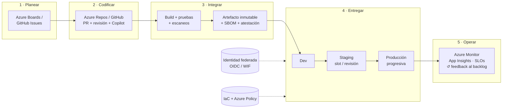

# CI/CD con Azure — Guía de referencia 2026

[](docs/13-novedades-y-ciclo-de-vida.md)

[](.github/workflows/validate.yml)
[](LICENSE)

Manual práctico y actualizado para **diseñar, construir y operar pipelines de CI/CD en Azure**:
Azure DevOps, GitHub Actions, estrategias de despliegue, infraestructura como código, seguridad de la
cadena de suministro y operación. Incluye **ejemplos listos para copiar** que se validan
automáticamente en cada cambio.

> [!NOTE]
> Toda la información está verificada contra la documentación oficial y las notas de versión vigentes
> al **24 de octubre de 2026**. Las fechas de retiro y los cambios próximos están en el
> [Radar 2026](docs/13-novedades-y-ciclo-de-vida.md).

---

## Contenido

- [Empieza aquí](#empieza-aquí)
- [Mapa de la documentación](#mapa-de-la-documentación)
- [El ciclo completo en un diagrama](#el-ciclo-completo-en-un-diagrama)
- [Las 10 reglas de oro](#las-10-reglas-de-oro)
- [Lo urgente: fechas que importan](#lo-urgente-fechas-que-importan)
- [Azure DevOps en una página](#azure-devops-en-una-página)
- [Ejemplos incluidos](#ejemplos-incluidos)
- [Cómo se mantiene esta guía](#cómo-se-mantiene-esta-guía)
- [Fuentes oficiales](#fuentes-oficiales)

---

## Empieza aquí

| Si tú… | Lee en este orden |
| --- | --- |
| **Empiezas con CI/CD** | [01 Fundamentos](docs/01-fundamentos-ci-cd.md) → [02 Azure DevOps](docs/02-azure-devops.md) → [03 Pipelines YAML](docs/03-azure-pipelines-yaml.md) → [ejemplos](examples/README.md) |
| **Ya usas Azure DevOps y quieres modernizarte** | [13 Radar](docs/13-novedades-y-ciclo-de-vida.md) → [03 Pipelines YAML](docs/03-azure-pipelines-yaml.md) (WIF, templates, MDP) → [08 Seguridad](docs/08-seguridad-devsecops.md) |
| **Trabajas con GitHub y despliegas a Azure** | [04 GitHub Actions](docs/04-github-actions-azure.md) → [05 Estrategias](docs/05-estrategias-de-despliegue.md) → [06 Destinos](docs/06-destinos-de-despliegue-azure.md) |
| **Vas a desplegar a producción pronto** | [Checklist de despliegue](docs/05-estrategias-de-despliegue.md#checklist-de-un-despliegue-a-producción) → [Línea base de seguridad](docs/08-seguridad-devsecops.md#línea-base-de-seguridad-checklist) → [Troubleshooting](docs/10-troubleshooting.md) |
| **Gestionas infraestructura** | [07 IaC](docs/07-infraestructura-como-codigo.md) → [ejemplos Bicep/Terraform](examples/README.md) |
| **Necesitas un comando ya** | [11 Cheatsheet](docs/11-cheatsheet.md) · [12 Glosario](docs/12-glosario.md) |

---

## Mapa de la documentación

| # | Guía | Qué aprenderás |
| --- | --- | --- |
| 01 | [Fundamentos de CI/CD](docs/01-fundamentos-ci-cd.md) | CI vs. entrega vs. despliegue continuo, principios, ramas, versionado, pruebas, DORA (5 métricas), platform engineering, agentes de IA |
| 02 | [Azure DevOps en 2026](docs/02-azure-devops.md) | Servicios, Services vs. Server, organización, identidad (adiós PATs globales), licencias, novedades, Azure DevOps vs. GitHub, línea de tiempo |
| 03 | [Azure Pipelines en YAML](docs/03-azure-pipelines-yaml.md) | Triggers, jobs, expresiones, templates `extends`, environments y checks, Workload Identity Federation, agentes y Managed DevOps Pools |
| 04 | [GitHub Actions para Azure](docs/04-github-actions-azure.md) | OIDC con Entra ID (subjects inmutables), environments, reusable workflows, runners 2026, hardening, equivalencias con Azure Pipelines |
| 05 | [Estrategias de despliegue](docs/05-estrategias-de-despliegue.md) | Blue-green, canary, rings, feature flags, migraciones de BD sin downtime, rollback automático |
| 06 | [Destinos de despliegue en Azure](docs/06-destinos-de-despliegue-azure.md) | App Service, Functions (Flex Consumption), Container Apps, AKS (GitOps, Gateway API), Static Web Apps, VMs, ACR, `azd` |
| 07 | [Infraestructura como código](docs/07-infraestructura-como-codigo.md) | Bicep, deployment stacks, AVM, Terraform 1.17 + AzureRM 5.x, estado remoto, Azure Policy, retiro de Blueprints |
| 08 | [Seguridad y DevSecOps](docs/08-seguridad-devsecops.md) | OWASP Top 10 CI/CD, identidad sin secretos, escaneos, SBOM, SLSA, firmas, incidentes 2025–2026 |
| 09 | [Observabilidad y operación](docs/09-observabilidad-y-operacion.md) | OpenTelemetry, anotaciones de despliegue, SLOs y gates, incidentes, costos de CI/CD |
| 10 | [Troubleshooting](docs/10-troubleshooting.md) | Errores frecuentes (AADSTS, agentes, swaps, Terraform…) con causa y solución |
| 11 | [Cheatsheet](docs/11-cheatsheet.md) | Comandos de `az`, `azd`, `bicep`, `terraform`, `kubectl`, `gh` y equivalencias de expresiones |
| 12 | [Glosario](docs/12-glosario.md) | Términos clave en inglés y español |
| 13 | [Radar 2026](docs/13-novedades-y-ciclo-de-vida.md) | Novedades, retiros y fechas límite hasta 2028, revisión trimestral |

---

## El ciclo completo en un diagrama



---

## Las 10 reglas de oro

1. **Todo como código**: pipelines, infraestructura y políticas en el repositorio, cambiados por PR.
2. **Build once, deploy many**: el mismo artefacto (zip o imagen **por digest**) llega a todos los ambientes.
3. **Cero secretos**: Workload Identity Federation / OIDC e identidades administradas. Nada de
   contraseñas de service principals ni PATs en pipelines.
4. **Mínimo privilegio**: una identidad por ambiente con RBAC al alcance mínimo; `permissions:`
   mínimos en GitHub y *job authorization scope* limitado en Azure DevOps.
5. **Dependencias fijadas**: acciones por SHA (o *lockfile*), imágenes y herramientas con versión;
   actualizaciones automáticas mediante PRs.
6. **PRs pequeños y rápidos**: validación en menos de 10 minutos, `main` siempre desplegable.
7. **Gates objetivos**: pruebas, escaneos, alertas y aprobaciones en environments (no en el YAML).
8. **Despliegue progresivo y reversible**: slots, revisiones, canary, rings y feature flags, con
   **rollback automático probado**.
9. **Observa cada despliegue**: versión en la telemetría, anotaciones y SLOs que deciden.
10. **Protege el pipeline como a producción**: ramas protegidas, CODEOWNERS en `/.github`,
    `/azure-pipelines` e `/infra`, runners efímeros y auditoría.

---

## Lo urgente: fechas que importan

| Fecha | Cambio | Qué hacer |
| --- | --- | --- |
| **2-nov-2026** | Se elimina la imagen **macOS 14** de Azure Pipelines | Usa `macOS-15` o `macOS-latest` |
| **10-nov-2026** | Fin de soporte de **.NET 8 / .NET 9** y del modelo **in-process** de Azure Functions | Migra a **.NET 10 LTS** y al *isolated worker* |
| **≤ 15-nov-2026** | `windows-2025` (Azure Pipelines) pasa a **Visual Studio 2026** | Prueba con `windows-2025-vs2026` |
| **24-nov-2026** | Se eliminan **Node.js 6/10/16** del agente de Azure Pipelines | Actualiza tareas y extensiones |
| **Nov-2026** | Kubernetes **1.34** EOL y fin de parches del add-on **NGINX** de AKS | Upgrade a 1.35+ y migración a **Gateway API** |
| **1-dic-2026** | Los **PATs globales** de Azure DevOps dejan de funcionar | PATs de una organización o tokens de **Microsoft Entra** |
| **31-ene-2027** | Retiro definitivo de **Azure Blueprints** | Migra a **deployment stacks** |
| **17-abr-2027** | **Ubuntu 22.04** fuera de Azure Pipelines y GitHub Actions | `ubuntu-24.04` / `ubuntu-26.04` |
| **1-jul-2027** | Retiro del emisor **Azure DevOps** en service connections con WIF | Convierte al emisor **Entra** |

Calendario completo, novedades y fuentes para estar al día: **[Radar 2026](docs/13-novedades-y-ciclo-de-vida.md)**.

---

## Azure DevOps en una página

**Azure DevOps** es la suite de Microsoft para planear, desarrollar, probar, entregar y mantener
software. Se ofrece como servicio en la nube (**Azure DevOps Services**) y on-premises
(**Azure DevOps Server**, versión sin año bajo *Modern Lifecycle Policy* desde diciembre de 2025).

| Servicio | Para qué sirve | Novedad destacada (2025–2026) |
| --- | --- | --- |
| **Azure Boards** | Backlogs, Kanban, sprints, planes de entrega | Integración con **GitHub Copilot coding agent** (GA ene-2026) |
| **Azure Repos** | Git privado con PRs y branch policies | **Code Search** integrado; **Copilot code review** (*preview*) |
| **Azure Pipelines** | CI/CD en YAML para cualquier lenguaje, plataforma y nube | Agente v5 (.NET 10), Ubuntu 26.04 y Windows 2025 + VS 2026, vista *Stages* |
| **Azure Test Plans** | Pruebas manuales y exploratorias con trazabilidad | *Test Run Hub*, historial por *test point* |
| **Azure Artifacts** | Feeds de paquetes (NuGet, npm, Maven, Python, Cargo, Universal) | Upstream sources y *feed views* para promoción |
| **Advanced Security** | Secret scanning, dependency y code scanning | **Secret Protection** y **Code Security**; CodeQL *default setup* GA |
| **MCP Server** | Conectar agentes de IA con Azure DevOps | Servidor remoto **GA** (ago-2026) |

**Cómo encaja en el flujo:** planear en **Boards** → código en **Repos** (o GitHub) → build y pruebas
en **Pipelines** → paquetes en **Artifacts** → pruebas manuales en **Test Plans** → despliegue con
environments, aprobaciones y checks → observación con Azure Monitor.

**Plataformas soportadas:** cualquier lenguaje (C#, Java, Python, JavaScript/TypeScript, Go, Rust,
C/C++, PHP, Ruby…), agentes Windows, Linux y macOS (x64 y ARM64), y despliegue a Azure, otras nubes,
Kubernetes, contenedores, VMs y on-premises.

| Fortalezas | Desafíos |
| --- | --- |
| Integración de punta a punta (planeación → producción) | Amplitud de funciones: requiere gobierno y convenciones |
| Environments, aprobaciones y checks muy maduros | Costos por usuario y paralelismo que hay que monitorear |
| Templates `extends` y controles empresariales | Migrar pipelines clásicos y PATs a YAML y Entra ID |
| Planeación y pruebas manuales que GitHub no cubre nativamente | Las novedades de IA y seguridad suelen llegar antes a GitHub |

Profundiza en [02 · Azure DevOps en 2026](docs/02-azure-devops.md), que incluye la
[línea de tiempo 2005–2026](docs/02-azure-devops.md#línea-de-tiempo) corregida y ampliada, y la
comparación [Azure DevOps o GitHub](docs/02-azure-devops.md#azure-devops-o-github).

---

## Ejemplos incluidos

| Plataforma | Ejemplos |
| --- | --- |
| Azure Pipelines | [CI/CD multi-etapa con slots y rollback](examples/azure-pipelines/webapp-ci-cd.yml) · [Terraform con WIF](examples/azure-pipelines/infra-terraform.yml) · [Bicep + deployment stack](examples/azure-pipelines/infra-bicep.yml) · [templates](examples/azure-pipelines/templates/) |
| GitHub Actions | [CI](examples/github-actions/ci.yml) · [CD Web App con OIDC](examples/github-actions/cd-webapp.yml) · [workflow reutilizable](examples/github-actions/reusable-deploy-webapp.yml) · [blue-green en Container Apps](examples/github-actions/cd-containerapps.yml) · [Terraform](examples/github-actions/infra-terraform.yml) · [Bicep](examples/github-actions/infra-bicep.yml) |
| Infraestructura | [Bicep](examples/bicep/) · [Terraform (AzureRM 5.x)](examples/terraform/) |

Guía de uso, prerrequisitos (identidades, RBAC, environments) y validación local:
[examples/README.md](examples/README.md).

---

## Cómo se mantiene esta guía

```text
.
├── README.md                  ← estás aquí
├── docs/                      ← 13 guías temáticas
├── examples/                  ← pipelines, workflows e IaC de referencia
├── scripts/                   ← validadores usados por la CI de este repo
└── .github/workflows/
    └── validate.yml           ← valida Markdown, enlaces, YAML, Bicep y Terraform en cada PR
```

Cada PR a este repositorio ejecuta [`validate.yml`](.github/workflows/validate.yml), que aplica las mismas
prácticas que recomienda la guía (permisos mínimos, acciones fijadas por SHA, `timeout-minutes`):

- **Markdown**: estilo con `markdownlint` y enlaces internos/anclas con [`scripts/check_links.py`](scripts/check_links.py).
- **GitHub Actions**: `actionlint` (incluye `shellcheck`) sobre los ejemplos.
- **Azure Pipelines**: estructura contra el esquema oficial con [`scripts/validate_azure_pipelines.py`](scripts/validate_azure_pipelines.py).
- **YAML**: `yamllint` con [`.yamllint.yml`](.yamllint.yml).
- **Bicep**: `bicep lint` + `build`; **Terraform**: `fmt -check` + `validate`.

Para actualizar: revisa el [Radar](docs/13-novedades-y-ciclo-de-vida.md) cada trimestre, cambia la fecha
de "Última revisión" de cada documento que edites y deja que la CI valide.

---

## Fuentes oficiales

- [Documentación de Azure DevOps](https://learn.microsoft.com/azure/devops/) · [Notas de versión](https://learn.microsoft.com/azure/devops/release-notes/) · [Blog](https://devblogs.microsoft.com/devops/)
- [Documentación de GitHub Actions](https://docs.github.com/actions) · [GitHub Changelog](https://github.blog/changelog/)
- [Azure Architecture Center](https://learn.microsoft.com/azure/architecture/) · [Well-Architected Framework](https://learn.microsoft.com/azure/well-architected/)
- [Azure Updates](https://azure.microsoft.com/updates/) · [Precios de Azure DevOps](https://azure.microsoft.com/pricing/details/devops/azure-devops-services/)
- [DORA](https://dora.dev/) · [SLSA](https://slsa.dev/) · [OWASP Top 10 CI/CD](https://owasp.org/www-project-top-10-ci-cd-security-risks/)

---

Distribuido bajo la [Licencia Apache 2.0](LICENSE). Azure, Azure DevOps y GitHub son marcas de
Microsoft Corporation; esta guía es independiente y no está afiliada a Microsoft.
