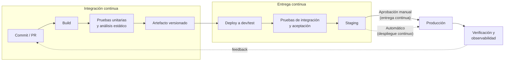
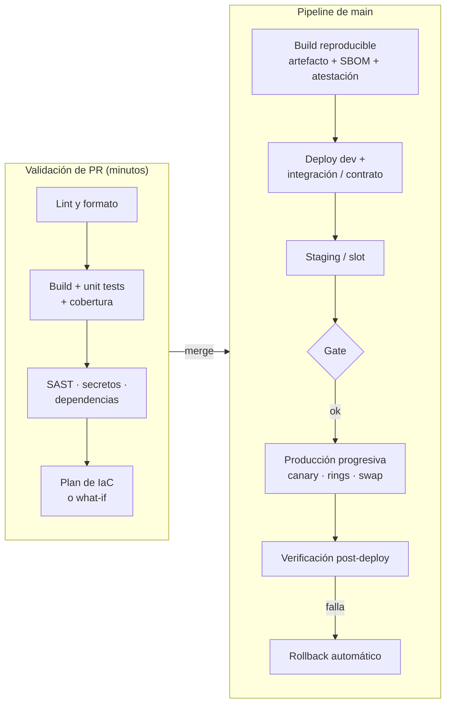
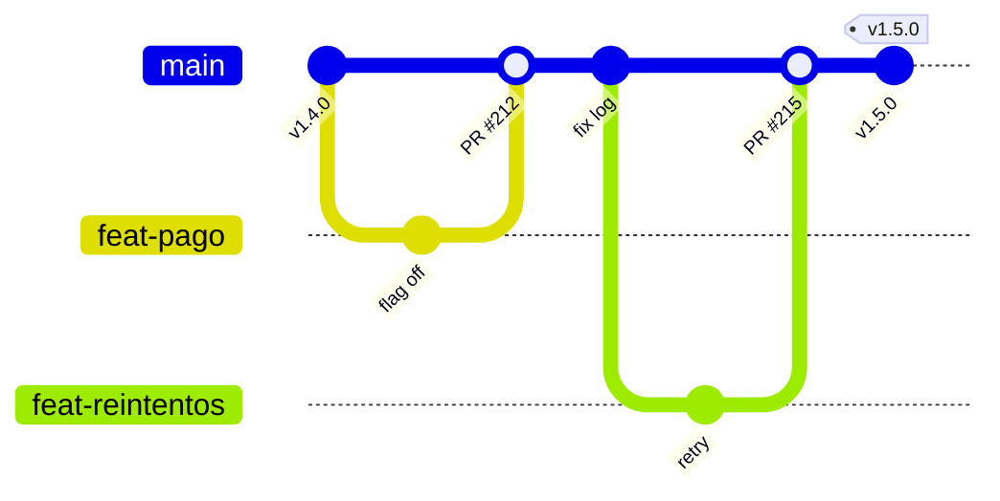
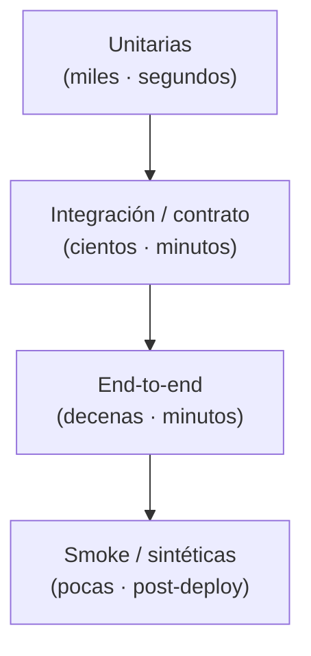

# 01 · Fundamentos de CI/CD

> Conceptos, principios y métricas que no cambian aunque cambien las herramientas.
> **Última revisión:** 24 de octubre de 2026.

[Índice](../README.md) · [Siguiente: Azure DevOps →](02-azure-devops.md)

---

## En esta guía

- [TL;DR](#tldr)
- [CI, entrega continua y despliegue continuo](#ci-entrega-continua-y-despliegue-continuo)
- [Anatomía de un pipeline moderno](#anatomía-de-un-pipeline-moderno)
- [Los 12 principios no negociables](#los-12-principios-no-negociables)
- [Estrategias de ramas](#estrategias-de-ramas)
- [Versionado y trazabilidad](#versionado-y-trazabilidad)
- [Pruebas dentro del pipeline](#pruebas-dentro-del-pipeline)
- [Artefactos y promoción entre ambientes](#artefactos-y-promoción-entre-ambientes)
- [Ambientes y configuración](#ambientes-y-configuración)
- [Métricas DORA](#métricas-dora)
- [Platform engineering y golden paths](#platform-engineering-y-golden-paths)
- [CI/CD en la era de los agentes de IA](#cicd-en-la-era-de-los-agentes-de-ia)
- [Anti-patrones frecuentes](#anti-patrones-frecuentes)
- [Checklist](#checklist)
- [Referencias](#referencias)

---

## TL;DR

- **CI** = integrar cambios pequeños al tronco varias veces al día, con build y pruebas automáticas.
- **Entrega continua** = cada cambio que pasa el pipeline *podría* ir a producción con un clic.
  **Despliegue continuo** = va solo, sin intervención humana.
- **Build once, deploy many**: un único artefacto inmutable se promueve entre ambientes.
- La identidad del pipeline debe ser **federada (OIDC)**, nunca contraseñas o secretos de larga vida.
- Mide con **DORA** (5 métricas): velocidad *y* estabilidad, siempre juntas.

---

## CI, entrega continua y despliegue continuo



| Práctica | Qué garantiza | Disparador típico | Gate hacia producción |
| --- | --- | --- | --- |
| Integración continua (CI) | El tronco siempre compila y pasa pruebas | Cada push / PR | — |
| Entrega continua (Continuous Delivery) | Cualquier versión verde es desplegable | Merge a `main` | Aprobación humana o ventana de cambio |
| Despliegue continuo (Continuous Deployment) | Toda versión verde llega a producción | Merge a `main` | Automático: pruebas + métricas + rollback |

> [!TIP]
> El despliegue continuo no es "más valiente", es **más disciplinado**: exige pruebas confiables,
> feature flags, despliegue progresivo y rollback automático. Empieza con entrega continua y
> automatiza el gate cuando tus métricas de estabilidad lo justifiquen.

---

## Anatomía de un pipeline moderno



**Presupuesto de tiempo** que conviene defender:

| Etapa | Objetivo | Si se excede |
| --- | --- | --- |
| Validación de PR | < 10 min | Paraleliza, usa caché, divide pruebas, mueve e2e a etapas posteriores |
| Build + artefacto en `main` | < 15 min | Revisa caché de dependencias, builds incrementales, runners más grandes |
| Despliegue a producción | < 30 min (sin contar aprobaciones) | Automatiza verificaciones; evita pasos manuales intermedios |

---

## Los 12 principios no negociables

1. **Todo como código**: pipelines (YAML), infraestructura (Bicep/Terraform), políticas (Azure Policy),
   configuración y hasta los dashboards. Lo que no está versionado no existe.
2. **Build once, deploy many**: el mismo artefacto (zip, imagen por *digest*, paquete) viaja de dev a
   producción. Recompilar por ambiente invalida todas tus pruebas.
3. **Lotes pequeños**: PRs cortos, integración diaria al tronco. Reduce conflictos y riesgo por cambio.
4. **Feedback rápido**: si el PR tarda 40 minutos en validarse, la gente lo evitará.
5. **Artefactos inmutables y trazables**: versión ↔ commit ↔ pipeline run ↔ ambiente. Nunca
   `latest` en producción.
6. **Paridad de ambientes**: mismos templates de IaC, distinta escala/parámetros.
7. **Identidad sin secretos**: Workload Identity Federation / OIDC + identidades administradas.
8. **Seguridad desde el inicio (shift-left)**: escaneo de secretos, SAST, SCA, IaC scanning en el PR,
   no en una auditoría trimestral.
9. **Gates automáticos**: aprobaciones donde aportan, pero sobre todo checks objetivos
   (pruebas, alertas de Azure Monitor, políticas, ventanas de cambio).
10. **Despliegue progresivo y reversible**: slots, revisiones, canary, rings y feature flags. El
    rollback debe estar probado, no sólo documentado.
11. **Observabilidad integrada**: cada despliegue deja huella (anotación, versión en telemetría) y
    se verifica con métricas reales, no sólo con "el pipeline terminó en verde".
12. **El pipeline es un sistema de producción**: tiene acceso privilegiado a tu nube. Protégelo como
    tal: ramas protegidas, revisión de cambios a pipelines, dependencias fijadas, runners efímeros.

---

## Estrategias de ramas

| Estrategia | Cómo funciona | Cuándo usarla | Riesgo |
| --- | --- | --- | --- |
| **Trunk-based development** | Ramas de vida corta (< 1–2 días) que se integran a `main`; lo incompleto se oculta con feature flags | Recomendada para equipos con CI sólida y despliegue frecuente | Requiere disciplina en pruebas y flags |
| **GitHub Flow** | Rama por feature → PR → merge a `main` → deploy | Equipos pequeños/medianos, servicios web | Ramas largas si no se limita su vida |
| **Release branches** | `main` + ramas `release/x.y` estabilizadas y con hotfixes | Software con versiones soportadas en paralelo (on-prem, móvil, SDKs) | Cherry-picks y deriva entre ramas |
| **GitFlow** | `develop`, `feature/*`, `release/*`, `hotfix/*`, `main` | Casi nunca en 2026 para servicios cloud | Integración tardía, merges dolorosos, lead time alto |



**Protecciones mínimas de `main`** (branch policies en Azure Repos o *rulesets* en GitHub):

- PR obligatorio con al menos 1 revisor (2 para código crítico) y resolución de comentarios.
- Build de validación obligatorio y checks de seguridad como *required status checks*.
- Prohibido el push directo y el force-push; historial lineal o *squash merge*.
- Revisores obligatorios (CODEOWNERS) para carpetas sensibles: `/.github/`, `/azure-pipelines/`, `/infra/`.

---

## Versionado y trazabilidad

- **SemVer** (`MAJOR.MINOR.PATCH`) para librerías, APIs públicas y paquetes. Para servicios internos
  basta con un identificador monotónico + SHA: `2026.10.24.3+sha.3d3c42e`.
- **Conventional Commits** (`feat:`, `fix:`, `feat!:`) permite generar changelogs y calcular la
  siguiente versión automáticamente (p. ej. con *release-please* o *semantic-release*).
- **Etiqueta todo**: la imagen con el SHA completo, el artefacto con el número de build, el despliegue
  con ambos. En Azure Pipelines, `name: $(Date:yyyyMMdd)$(Rev:.r)` define `Build.BuildNumber`.
- **Despliega imágenes por digest** (`miapp@sha256:...`), no por tag: los tags se pueden mover.

```text
commit 3d3c42e ─► build 20261024.3 ─► artefacto webapp.zip (sha256:9f1...)
                                     ─► imagen crmiapp.azurecr.io/miapp@sha256:7ab...
                                     ─► atestación SLSA firmada (quién, cómo, desde dónde)
                                     ─► desplegado en: dev ✓ · staging ✓ · prod ✓ (24-oct 18:05)
```

---

## Pruebas dentro del pipeline



| Tipo | Dónde corre | Bloquea | Notas |
| --- | --- | --- | --- |
| Unitarias + cobertura | PR y `main` | Sí | Publica resultados y cobertura (`PublishTestResults`, `PublishCodeCoverageResults@2`) |
| Análisis estático / lint | PR | Sí | Rápido y barato: atrapa errores antes del build |
| SAST, secretos, dependencias | PR | Sí (críticos/altos) | CodeQL, secret scanning, dependency review |
| Integración y contrato | `main` tras deploy a dev | Sí | Bases de datos efímeras, Testcontainers, Pact |
| End-to-end | Staging / slot | Sí | Pocas y estables; las inestables (*flaky*) se arreglan o se borran |
| Carga y rendimiento | Staging (programado o por release) | Según SLO | Azure Load Testing con criterios de aprobación |
| Smoke post-deploy | Cada ambiente | Sí → dispara rollback | `/healthz`, transacción sintética, Application Insights availability tests |

> [!WARNING]
> Una prueba inestable que se "re-ejecuta hasta que pase" destruye la confianza en el pipeline.
> Pon en cuarentena explícita (con dueño y fecha) o elimínala; nunca la ignores en silencio.

---

## Artefactos y promoción entre ambientes

| Tipo de artefacto | Dónde guardarlo en Azure / GitHub | Cómo se promueve |
| --- | --- | --- |
| Paquete de app (zip) | Pipeline artifacts / GitHub artifacts (corto plazo), Azure Artifacts *Universal Packages* (largo plazo) | Mismo artefacto descargado por cada etapa |
| Imagen de contenedor | Azure Container Registry (geo-replicado en prod) | Mismo *digest*; opcional `az acr import` a un registry de producción |
| Paquetes (NuGet, npm, Maven, Python, Cargo) | Azure Artifacts o GitHub Packages, con *upstream sources* | *Feed views* (`@prerelease` → `@release`) |
| Plantillas de IaC | Repo Git (con tags) o *template specs* / registro Bicep privado | Versión fija por ambiente |

Acompaña cada artefacto de producción con **SBOM** y **atestación de procedencia** (ver
[DevSecOps](08-seguridad-devsecops.md)).

---

## Ambientes y configuración

- **Separa configuración de código** (12-factor): el artefacto es el mismo; cambian app settings,
  [Azure App Configuration](https://learn.microsoft.com/azure/azure-app-configuration/) y referencias
  a [Key Vault](https://learn.microsoft.com/azure/key-vault/).
- **Una suscripción (o al menos un resource group) por ambiente**, con identidades de despliegue
  distintas: un error en dev no debe poder tocar producción.
- **Ambientes efímeros por PR** cuando aporten valor: *preview environments* de Static Web Apps,
  una revisión etiquetada en Container Apps o un namespace temporal en AKS. Destrúyelos al cerrar el PR.
- **Datos**: nunca copies datos personales de producción a ambientes bajos sin anonimizar.

---

## Métricas DORA

Desde el informe 2024, DORA mide el desempeño de entrega de software con **cinco métricas** en dos
dimensiones:

| Dimensión | Métrica | Pregunta que responde |
| --- | --- | --- |
| Throughput | **Change lead time** (tiempo de entrega de cambios) | ¿Cuánto tarda un commit en llegar a producción? |
| Throughput | **Deployment frequency** (frecuencia de despliegue) | ¿Cada cuánto desplegamos a producción? |
| Throughput | **Failed deployment recovery time** (tiempo de recuperación) | Cuando un despliegue falla, ¿cuánto tardamos en restaurar el servicio? |
| Inestabilidad | **Change fail rate** (tasa de fallo de cambios) | ¿Qué % de despliegues requiere intervención inmediata? |
| Inestabilidad | **Deployment rework rate** (tasa de retrabajo) | ¿Qué % de despliegues son no planeados, para corregir un incidente? |

Lo que aporta el informe **2025 (*State of AI-assisted Software Development*)**:

- La adopción de IA ya se asocia con **más throughput**, pero también con **más inestabilidad** si no
  hay buenas bases: la IA *amplifica* lo que ya tiene el equipo, para bien o para mal.
- Introduce el **DORA AI Capabilities Model**: postura clara sobre el uso de IA, ecosistemas de datos
  sanos, datos internos accesibles para la IA, control de versiones sólido, trabajo en lotes
  pequeños, foco en el usuario y plataformas internas de calidad.
- Reemplaza los niveles "low/medium/high/elite" por **arquetipos de equipo**: compárate contigo mismo
  a lo largo del tiempo, no con un ranking.

**Cómo medirlas en la práctica**

- *Azure Pipelines*: los **environments** registran cada despliegue (qué run, qué commits, cuándo);
  la vista **Stages** (2026) muestra qué versión está en cada etapa. Usa Analytics/OData o la REST API
  para calcular frecuencia y lead time.
- *GitHub*: la API de **deployments** y **environments** + métricas de Actions; o una herramienta
  como Apache DevLake o los *DORA Four Keys*.
- *Incidentes*: correlaciona con tu herramienta de incidentes (Azure Monitor alerts, ServiceNow,
  PagerDuty) para obtener fallos y recuperación.

> [!CAUTION]
> Las métricas DORA son para que el equipo mejore, no para comparar o castigar equipos. En cuanto
> se vuelven objetivo de desempeño individual, se manipulan (Ley de Goodhart).

---

## Platform engineering y golden paths

Escalar CI/CD en una organización no es copiar YAML entre repos: es ofrecer **caminos pavimentados**.

| Necesidad | Azure DevOps | GitHub |
| --- | --- | --- |
| Plantilla obligatoria y segura | `extends` templates + check **Required template** en recursos protegidos | *Reusable workflows* + *rulesets* con workflows requeridos |
| Pasos reutilizables | Templates de steps/jobs/stages en un repo central (`resources.repositories`) | Composite actions y reusable workflows |
| Inyección transversal (p. ej. escáner) | Pipeline decorators (extensión) | Workflows requeridos por ruleset a nivel organización |
| Catálogo de plantillas | Repo de templates versionado con tags | *Workflow templates* de la organización (`.github` repo) |
| Autoservicio de infraestructura | Template specs, deployment stacks, módulos AVM | Ídem + Azure Developer CLI (`azd`) |

---

## CI/CD en la era de los agentes de IA

A octubre de 2026 los agentes de código ya forman parte del flujo diario:

- **GitHub Copilot coding agent** crea PRs desde issues, y desde **Azure Boards** (integración GA en
  enero de 2026, con soporte de *custom agents*).
- **Copilot code review** revisa PRs en GitHub y, desde septiembre de 2026, en **Azure Repos**
  (*public preview*), configurable vía branch policies.
- **Servidores MCP**: el **Azure DevOps Remote MCP Server** (GA en agosto de 2026,
  `https://mcp.dev.azure.com/{organización}`) y el MCP de GitHub permiten que los agentes consulten
  work items, PRs, pipelines y logs.

Reglas de oro:

1. **Mismos gates para humanos y agentes**: el código generado pasa por las mismas pruebas,
   escaneos, revisiones y aprobaciones. Sin excepciones "porque lo hizo la IA".
2. **Mínimo privilegio para agentes**: tokens con alcance limitado y de vida corta; nunca PATs globales.
3. **Lotes pequeños**: los agentes tienden a generar PRs grandes; limita el tamaño o divídelos.
4. **Trazabilidad**: identifica en el PR qué se generó con IA y quién lo revisó.

---

## Anti-patrones frecuentes

| Anti-patrón | Por qué duele | Alternativa |
| --- | --- | --- |
| Compilar en cada ambiente | Lo que se probó no es lo que se despliega | Un artefacto, promovido |
| Secretos de service principal en variables | Rotación manual, fugas, MFA no aplica | Workload Identity Federation / OIDC |
| `latest` en imágenes y runners | Builds no reproducibles, sorpresas | Versiones fijas + actualizaciones vía PR (Dependabot/Renovate) |
| Pipelines editados a mano en la UI | Sin revisión ni historial | YAML en el repo, cambios por PR |
| Aprobaciones para todo | Cuellos de botella y aprobaciones "en automático" | Checks objetivos + aprobación sólo en producción |
| Rollback = "re-desplegar la versión anterior a mano" | Lento y propenso a errores | Swap, revisión anterior, `helm rollback`, feature flag off |
| Migraciones de BD destructivas en el mismo release | Imposible revertir | Expand/contract en varios releases |
| Un solo service principal "Owner" para todo | Radio de impacto total | Una identidad por ambiente y propósito, con RBAC mínimo |

---

## Checklist

- [ ] `main` protegida: PR, revisores, build de validación, checks de seguridad obligatorios.
- [ ] PR validado en < 10 minutos.
- [ ] Un único artefacto versionado y trazable al commit, promovido entre ambientes.
- [ ] Pipelines e infraestructura como código, revisados por PR (con CODEOWNERS).
- [ ] Identidades federadas por ambiente; cero secretos de larga vida en el pipeline.
- [ ] Despliegue a producción progresivo con verificación y rollback automático.
- [ ] Métricas DORA visibles para el equipo y revisadas en retrospectivas.

---

## Referencias

- [DORA — Research y guías de capacidades](https://dora.dev/)
- [Microsoft Learn — What is DevOps?](https://learn.microsoft.com/devops/what-is-devops)
- [Trunk Based Development](https://trunkbaseddevelopment.com/)
- [Conventional Commits](https://www.conventionalcommits.org/)
- [The Twelve-Factor App](https://12factor.net/)
- [Martin Fowler — Continuous Integration](https://martinfowler.com/articles/continuousIntegration.html)

[Índice](../README.md) · [Siguiente: Azure DevOps →](02-azure-devops.md)
