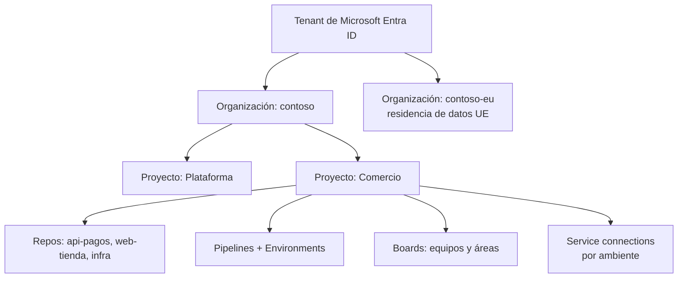
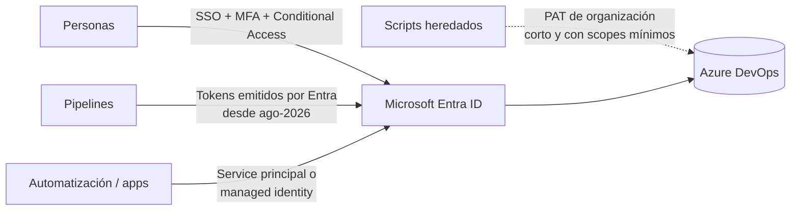

# 02 · Azure DevOps en 2026

> Servicios, organización, identidad, licencias, novedades y hacia dónde va la plataforma.
> **Última revisión:** 24 de octubre de 2026.

[← Fundamentos](01-fundamentos-ci-cd.md) · [Índice](../README.md) · [Siguiente: Azure Pipelines YAML →](03-azure-pipelines-yaml.md)

---

## En esta guía

- [TL;DR](#tldr)
- [Qué es Azure DevOps hoy](#qué-es-azure-devops-hoy)
- [Services vs. Server](#services-vs-server)
- [Cómo organizar organizaciones, proyectos y repos](#cómo-organizar-organizaciones-proyectos-y-repos)
- [Identidad, acceso y autenticación](#identidad-acceso-y-autenticación)
- [Licencias y precios](#licencias-y-precios)
- [Novedades 2025–2026 que debes conocer](#novedades-20252026-que-debes-conocer)
- [Azure DevOps o GitHub](#azure-devops-o-github)
- [Rutas de migración](#rutas-de-migración)
- [Configuración segura de una organización](#configuración-segura-de-una-organización)
- [Línea de tiempo](#línea-de-tiempo)
- [Referencias](#referencias)

---

## TL;DR

- Azure DevOps sigue siendo **plenamente soportado** para proyectos privados y empresariales, con
  entregas cada ~3 semanas (sprints 268–280 en 2026).
- La dirección es clara: **identidad Microsoft Entra en todo** (adiós PATs globales el
  **1-dic-2026**, OAuth propio de Azure DevOps en retiro, tokens de pipeline emitidos por Entra),
  **IA integrada** (Copilot en Boards y Repos, servidor MCP remoto GA) y **convergencia con GitHub**
  (proyectos públicos retirados, licencia Basic incluida con GitHub Enterprise, migración a GHEC).
- Para pipelines nuevos: **YAML multi-etapa**, **Workload Identity Federation** con emisor Entra y
  **Managed DevOps Pools** cuando necesites agentes propios.

---

## Qué es Azure DevOps hoy

Azure DevOps es una suite SaaS (y on-premises con *Azure DevOps Server*) para planear, construir,
probar y entregar software. Sus servicios se pueden usar juntos o por separado, y se integran con
GitHub.

| Servicio | Para qué sirve | Lo más relevante en 2025–2026 |
| --- | --- | --- |
| **Azure Boards** | Backlogs, Kanban, sprints, planes de entrega, consultas | *New Boards Hub* para todos (jul-2025); integración GA con **GitHub Copilot coding agent** (ene-2026) y *custom agents*; anotaciones de PR en tarjetas (jul-2026); hasta 2,000 repos de GitHub conectados por proyecto |
| **Azure Repos** | Git privado con PRs y *branch policies* (y TFVC heredado) | **Code Search integrado** sin extensión (abr-2026); **Copilot code review** en *public preview* (sep-2026); auto-complete de PRs por defecto (configurable) |
| **Azure Pipelines** | CI/CD multiplataforma (YAML o clásico) | Agente **v5 (.NET 10)**; imágenes Ubuntu 26.04 y Windows Server 2025 + VS 2026; vista **Stages** con historial de despliegues; agentes "GitHub-hosted" de pago por minuto (*preview*) |
| **Azure Test Plans** | Pruebas manuales/exploratorias, trazabilidad | Nuevo *Test Run Hub*, historial por *test point*, asociar pruebas automatizadas (Java/JS/Python) a casos de prueba |
| **Azure Artifacts** | Feeds NuGet, npm, Maven, Python, Cargo, Universal | Upstream sources, *feed views* para promoción, 2 GiB gratis |
| **Advanced Security** | Secret scanning, push protection, dependency y code scanning (CodeQL) | Vendido como **GitHub Secret Protection** y **GitHub Code Security** (jun-2025); **CodeQL default setup GA** (jul-2026); Copilot Autofix; datos EPSS para priorizar |
| **Wiki, Dashboards, Analytics** | Documentación, tableros, OData | Editor Monaco en Wiki (*roadmap*), auditoría ampliada |
| **MCP Server** | Conectar agentes de IA con work items, repos y pipelines | Servidor **remoto GA** (ago-2026): `https://mcp.dev.azure.com/{organización}` |

---

## Services vs. Server

| | **Azure DevOps Services** (nube) | **Azure DevOps Server** (on-premises) |
| --- | --- | --- |
| Actualizaciones | Continuas (cada sprint) | Versión única "sin año" bajo **Modern Lifecycle Policy** desde su GA el **9-dic-2025** |
| Agentes hospedados por Microsoft | Sí | No: sólo agentes propios |
| Advanced Security, Copilot, MCP remoto | Sí | Funcionalidad limitada / tardía |
| Cuándo elegirlo | Default para casi todos | Requisitos regulatorios o de red que impidan la nube |

> [!NOTE]
> Desde Azure DevOps Server (sin año) ya no hay versiones mayores cada dos años: el soporte depende
> de **mantenerse actualizado**. Se puede actualizar directamente desde Server 2022, 2020, 2019 y
> TFS 2015+. Para pasar de Server a Services existe la **Azure DevOps Data Migration Tool**
> (actualizada en mayo de 2026).

---

## Cómo organizar organizaciones, proyectos y repos

Recomendaciones:

- **Pocas organizaciones** (idealmente una por empresa o por requisito de residencia de datos),
  respaldadas por **Microsoft Entra ID**. Desde nov-2025, crear una organización nueva requiere una
  **suscripción de Azure** vinculada.
- **Pocos proyectos, muchos repos**: un proyecto por dominio de negocio o plataforma. Los permisos,
  service connections y environments viven a nivel proyecto; demasiados proyectos multiplican la
  administración.
- **Áreas e iteraciones** para separar equipos dentro del mismo proyecto.
- **Un repo por servicio desplegable** (o monorepo con *path filters* y *sparse checkout*).

---

## Identidad, acceso y autenticación

### Niveles de acceso

| Nivel | Incluye | Costo |
| --- | --- | --- |
| **Stakeholder** | Boards (work items), ver pipelines, aprobar despliegues | Gratis |
| **Basic** | Repos, Pipelines, Boards completos, Artifacts | Primeros 5 usuarios gratis |
| **Basic + Test Plans** | Lo anterior + Azure Test Plans | De pago |
| **Suscriptores Visual Studio** | Según la suscripción (Enterprise incluye Test Plans) | Incluido en la suscripción |
| **Usuarios de GitHub Enterprise** | Basic incluido automáticamente (desde feb-2025) | Incluido en GHE |

### Autenticación: de PATs a Microsoft Entra

| Cambio | Fecha | Qué hacer |
| --- | --- | --- |
| No se registran nuevas **apps OAuth de Azure DevOps** | Desde abr-2025 | Usar **Microsoft Entra ID OAuth** |
| Retiro de la plataforma **Azure DevOps OAuth** | 2026 (fecha final por anunciar) | Migrar apps existentes a Entra |
| **Continuous Access Evaluation** (revocación casi en tiempo real) | GA ago-2025 | Manejar *claims challenges* en clientes propios |
| PATs **expirados ya no se pueden extender** | mar-2026 | Regenerar o, mejor, migrar a Entra |
| **PATs globales dejan de funcionar** | **1-dic-2026** | Usar PATs de **una organización** o tokens de Entra |
| Builds autenticados con **tokens emitidos por Entra** | ago-2026 | No decodificar `System.AccessToken`; usar APIs REST soportadas |
| Política **Restrict PAT creation** | *Preview* desde 2025 | Allowlist de quién puede crear PATs |

> [!IMPORTANT]
> **Service principals e identidades administradas** pueden agregarse como usuarios de la
> organización y autenticarse con tokens de Entra. Úsalos para automatización en lugar de PATs de
> personas. En pipelines, la nueva service connection **"Azure DevOps"** (2026) da acceso a otras
> organizaciones/feeds con identidad federada, sin PAT.

---

## Licencias y precios

Precios de lista en USD (consulta siempre la [página oficial](https://azure.microsoft.com/pricing/details/devops/azure-devops-services/)):

| Concepto | Gratis | De pago |
| --- | --- | --- |
| Usuarios Basic | 5 primeros | ~US$6 por usuario/mes |
| Basic + Test Plans | — | ~US$52 por usuario/mes |
| Stakeholders | Ilimitados | — |
| Jobs paralelos hospedados por Microsoft | 1 job, máx. 60 min por job, **1,800 min/mes** (requiere vincular facturación) | ~US$40/mes por job paralelo, sin límite de minutos y hasta 360 min por job |
| Jobs paralelos self-hosted | 1 + 1 por cada suscriptor VS Enterprise | ~US$15/mes por job paralelo |
| Agentes "GitHub-hosted" (Apple Silicon, 8–16+ núcleos) | — | **Pago por minuto** (*preview*, sin capa gratis) |
| Azure Artifacts | 2 GiB | Por GiB adicional (escalonado) |
| GitHub Secret Protection / Code Security | — | US$19 / US$30 por *committer* activo/mes |

> [!TIP]
> Un job paralelo sólo se consume mientras corre en un agente: las etapas **esperando aprobación no
> consumen** paralelismo, y los *server jobs* tampoco. Regla práctica: un job paralelo por cada
> 4–5 desarrolladores, y mide con el **Pool consumption report**.

---

## Novedades 2025–2026 que debes conocer

### Pipelines y agentes

- **Agente v5** sobre .NET 10 (v4 usaba .NET 8). Verifica que el SO de tus agentes propios esté
  soportado por .NET 10 antes de la actualización automática.
- **Node.js 6, 10 y 16 se eliminan del agente el 24-nov-2026**. Activa *Restrict out of support
  Node.js versions in pipeline tasks* para probar antes. Node 20 sale de soporte en el agente en
  abril de 2026 y se elimina en abril de 2027; Node 24 ya está incluido.
- Imágenes hospedadas: **Ubuntu 26.04 GA** y **Windows Server 2025 + Visual Studio 2026 GA**
  (29-sep-2026); `windows-2025` pasa a VS 2026 a más tardar el **15-nov-2026**; **macOS 14 se
  elimina el 2-nov-2026**; **Ubuntu 22.04 se elimina el 17-abr-2027**.
- **Workload Identity Federation** con **emisor Entra** por defecto (2025). El emisor
  "Azure DevOps" (`vstoken.dev.azure.com`) se **retira el 1-jul-2027**: convierte las service
  connections antiguas con el botón *Update*.
- Las service connections **sin uso por 100 días se deshabilitan** automáticamente (jul-2026).
- `mapDockerSocket` es `false` por defecto en *container jobs* Linux desde el agente 5.279.0.
- Funciones nuevas de expresión `iif()` y `trim()`, parámetro `stringList`, `ManualValidation@1` con
  `approvers`, *sparse checkout* en Azure Repos, propiedad `group` de stages y vista **Stages**.
- Comentario requerido para validar PRs de **forks** de GitHub configurable de forma independiente.
- **Managed DevOps Pools** GA: reemplazo de los *VMSS agent pools*.

### Seguridad y gobierno

- Advanced Security dividido en **Secret Protection** y **Code Security**; CodeQL *default setup*
  GA (sin YAML), soporte C/C++, Copilot Autofix con contexto del repo, EPSS en alertas de
  dependencias, alertas de malware (*roadmap*).
- Auditoría: eventos de service hooks y licenciamiento; *streaming* a Azure Monitor con autorización Entra.
- **SNI obligatorio** para conectarse a Azure DevOps Services (desde abr-2025).

### Plataforma

- **Proyectos públicos retirados** (abr-2026): ya no se crean; los existentes se convierten a
  privados en 2027 y pierden los minutos ilimitados de pipelines. Lo público va a GitHub.
- **Enterprise Live Migrations** (*private preview*): migración de repos de Azure Repos a GitHub
  Enterprise Cloud con residencia de datos, con mínima interrupción.

> El calendario completo de fechas límite está en [13 · Radar 2026](13-novedades-y-ciclo-de-vida.md).

---

## Azure DevOps o GitHub

| Si necesitas… | Mejor opción | Por qué |
| --- | --- | --- |
| Código abierto, comunidad, *forks* públicos | **GitHub** | Azure DevOps retiró los proyectos públicos |
| Planeación empresarial compleja (jerarquías, *delivery plans*, procesos heredados) | **Azure Boards** (puede convivir con código en GitHub) | Modelo de work items y procesos personalizables |
| Pruebas manuales con trazabilidad formal | **Azure Test Plans** | No hay equivalente nativo en GitHub |
| Ecosistema de acciones/marketplace, Copilot de punta, seguridad integrada | **GitHub** | Las novedades suelen llegar antes |
| Pipelines con aprobaciones, environments y checks muy maduros, *classic* heredado | **Azure Pipelines** (funciona también con repos de GitHub) | Checks de environment, templates `extends`, decoradores |
| On-premises / desconectado | **Azure DevOps Server** o GitHub Enterprise Server | — |

**Modelo híbrido muy común:** código en GitHub (con Copilot y Advanced Security), planeación en
Azure Boards (con la integración GitHub) y CI/CD en GitHub Actions o Azure Pipelines. Los usuarios
de GitHub Enterprise ya tienen **Basic** en Azure DevOps sin costo adicional.

---

## Rutas de migración

| De → A | Herramienta / enfoque |
| --- | --- |
| TFVC → Git | `git tfs` o importación de repositorio (historial limitado); congelar TFVC y mover |
| Pipelines clásicos → YAML | *Export to YAML* en builds clásicos; reescribir releases como etapas con `deployment` jobs y environments |
| VMSS agent pools → Managed DevOps Pools | Crear pool MDP con las mismas imágenes; cambiar `pool.name` |
| Azure DevOps Server → Services | Azure DevOps Data Migration Tool |
| Azure Repos → GitHub | GitHub Enterprise Importer; **Enterprise Live Migrations** (*preview*, para GHEC con residencia de datos) |
| Azure Pipelines → GitHub Actions | GitHub Actions Importer (audita, estima y convierte) |

---

## Configuración segura de una organización

**Organization settings → Pipelines → Settings** (y equivalentes por proyecto):

- [ ] **Disable creation of classic build pipelines** y **classic release pipelines** (por defecto en
      organizaciones nuevas desde 2023).
- [ ] **Limit job authorization scope to current project** (para pipelines YAML y releases).
- [ ] **Protect access to repositories in YAML pipelines** (obliga a declarar `resources.repositories`/`uses`).
- [ ] **Disable stage chooser** y **Limit building pull requests from forked GitHub repositories**
      (exige comentario de un miembro antes de validar PRs de forks).
- [ ] **Restrict out of support Node.js versions in pipeline tasks** (prueba antes del 24-nov-2026).
- [ ] Política **Restrict personal access token (PAT) creation** + PATs globales eliminados.
- [ ] **Conditional Access** y MFA vía Entra; acceso de invitados controlado.
- [ ] **Auditoría** con *streaming* a Azure Monitor Logs / Sentinel.
- [ ] **Advanced Security** (al menos Secret Protection con *push protection*) en repos activos.
- [ ] Revisión trimestral de service connections, agent pools, extensiones y permisos de grupos.

---

## Línea de tiempo

| Año | Hito |
| --- | --- |
| 2005–2006 | **Visual Studio 2005 Team System** y **Team Foundation Server 2005**: ALM integrado on-premises |
| 2010 | TFS 2010: colecciones de proyectos, builds con Windows Workflow (XAML), mejoras ágiles |
| 2012 | **Team Foundation Service**: primera versión en la nube |
| 2013 | Soporte de **Git** (TFS 2013 y servicio en la nube); el servicio pasa a llamarse **Visual Studio Online** |
| 2015 | Nuevo sistema de builds basado en tareas y agentes multiplataforma; renombrado a **Visual Studio Team Services (VSTS)** |
| 2017 | Builds en **YAML** (*preview*) |
| 2018 | **VSTS → Azure DevOps** (10-sep-2018): Boards, Repos, Pipelines, Test Plans y Artifacts como servicios independientes; Azure Pipelines gratis para código abierto |
| 2019 | **Azure DevOps Server 2019** (TFS cambia de nombre); pipelines YAML multi-etapa en *preview* |
| 2020 | Pipelines YAML multi-etapa **GA**, environments y checks; Azure DevOps Server 2020 |
| 2022 | Azure DevOps Server 2022 |
| 2023 | **GitHub Advanced Security for Azure DevOps** GA; creación de pipelines clásicos deshabilitada por defecto en organizaciones nuevas |
| 2024 | **Workload Identity Federation** GA (feb); **Managed DevOps Pools** (*preview* → GA) |
| 2025 | Advanced Security como Secret Protection + Code Security; servidor MCP local (*preview* jun, GA nov); New Boards Hub para todos; no más apps OAuth nuevas; emisor Entra para WIF; Basic incluido con GitHub Enterprise; **Azure DevOps Server** sin año GA (9-dic) |
| 2026 | Copilot en Boards GA (ene); proyectos públicos retirados (abr); Code Search integrado (abr); agente v5/.NET 10; **MCP remoto GA** (ago); Copilot code review en Repos (*preview*, sep); Ubuntu 26.04 y Windows 2025 + VS 2026 (sep–oct); **PATs globales retirados** (1-dic) |

---

## Referencias

- [Azure DevOps — documentación](https://learn.microsoft.com/azure/devops/)
- [Notas de versión de Azure DevOps](https://learn.microsoft.com/azure/devops/release-notes/)
- [Roadmap de funcionalidades](https://learn.microsoft.com/azure/devops/release-notes/features-timeline)
- [Precios de Azure DevOps Services](https://azure.microsoft.com/pricing/details/devops/azure-devops-services/)
- [Retiro de proyectos públicos](https://learn.microsoft.com/azure/devops/organizations/projects/public-projects-retirement)
- [Autenticación con Microsoft Entra en Azure DevOps](https://learn.microsoft.com/azure/devops/integrate/get-started/authentication/entra)
- [Azure DevOps Remote MCP Server](https://learn.microsoft.com/azure/devops/mcp-server/remote-mcp-server)
- [Blog de Azure DevOps](https://devblogs.microsoft.com/devops/)

[← Fundamentos](01-fundamentos-ci-cd.md) · [Índice](../README.md) · [Siguiente: Azure Pipelines YAML →](03-azure-pipelines-yaml.md)
