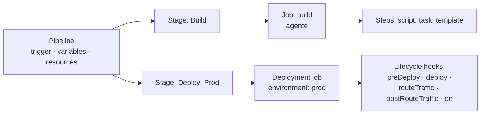
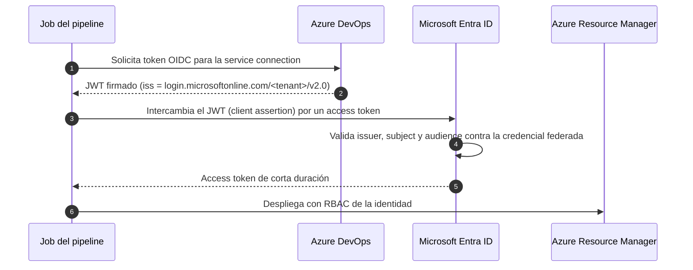

# 03 · Azure Pipelines en YAML (guía de experto)

> Estructura, triggers, variables, templates, environments, service connections, agentes y
> seguridad. Todo lo necesario para escribir pipelines mantenibles y seguros.
> **Última revisión:** 24 de octubre de 2026.

[← Azure DevOps](02-azure-devops.md) · [Índice](../README.md) · [Siguiente: GitHub Actions →](04-github-actions-azure.md)

---

## En esta guía

- [TL;DR](#tldr)
- [Jerarquía de un pipeline](#jerarquía-de-un-pipeline)
- [Triggers](#triggers)
- [Jobs: tipos, dependencias y condiciones](#jobs-tipos-dependencias-y-condiciones)
- [Variables, parámetros y expresiones](#variables-parámetros-y-expresiones)
- [Templates: includes y extends](#templates-includes-y-extends)
- [Deployment jobs y environments](#deployment-jobs-y-environments)
- [Service connections y Workload Identity Federation](#service-connections-y-workload-identity-federation)
- [Agentes: hospedados, Managed DevOps Pools y propios](#agentes-hospedados-managed-devops-pools-y-propios)
- [Rendimiento: caché, artefactos y checkout](#rendimiento-caché-artefactos-y-checkout)
- [Seguridad del pipeline](#seguridad-del-pipeline)
- [De pipelines clásicos a YAML](#de-pipelines-clásicos-a-yaml)
- [Variables predefinidas más útiles](#variables-predefinidas-más-útiles)
- [Referencias](#referencias)

---

## TL;DR

- Usa **YAML multi-etapa** con `deployment` jobs sobre **environments** (aprobaciones y checks fuera
  del YAML, donde un PR no los puede quitar).
- Autentícate con **service connections ARM con Workload Identity Federation** (emisor Entra).
  Las conexiones con emisor Azure DevOps se retiran el **1-jul-2027**.
- Estandariza con **templates `extends`** en un repo central y exige el check **Required template**.
- Fija imágenes (`ubuntu-24.04`, no `ubuntu-latest`) y versiones de herramientas.
- Ejemplo completo: [`examples/azure-pipelines/webapp-ci-cd.yml`](../examples/azure-pipelines/webapp-ci-cd.yml).

---

## Jerarquía de un pipeline



```yaml
trigger:
  branches:
    include: [main]

pool:
  vmImage: ubuntu-24.04

stages:
- stage: Build
  jobs:
  - job: build
    steps:
    - script: dotnet build --configuration Release
      displayName: Build

- stage: Deploy
  dependsOn: Build
  condition: and(succeeded(), eq(variables['Build.SourceBranch'], 'refs/heads/main'))
  jobs:
  - deployment: web
    environment: miapp-prod
    strategy:
      runOnce:
        deploy:
          steps:
          - script: echo "desplegando $(Build.BuildNumber)"
```

Reglas que conviene recordar:

- Un pipeline puede omitir `stages` (un solo stage implícito) o `jobs` (un solo job implícito).
- Las etapas corren **en secuencia por defecto** (cada una depende de la anterior); usa
  `dependsOn: []` para paralelizarlas.
- Los jobs dentro de una etapa corren **en paralelo por defecto** si hay agentes/paralelismo.
- Nombres de stages y jobs: letras, números y `_`; deben empezar con letra.

---

## Triggers

| Trigger | Sintaxis | Notas |
| --- | --- | --- |
| CI | `trigger:` con `branches`, `paths`, `tags`, `batch` | `trigger: none` lo desactiva. `batch: true` agrupa commits mientras corre una ejecución |
| PR (GitHub / Bitbucket) | `pr:` con `branches`, `paths`, `drafts` | En **Azure Repos se ignora**: usa una *branch policy* de **Build validation** |
| Programado | `schedules:` con `cron` (UTC), `branches`, `always` | `always: false` evita correr si no hubo cambios |
| Pipeline completado | `resources.pipelines[].trigger` | Encadena pipelines (build → release) |
| Repositorio externo | `resources.repositories[].trigger` | Dispara al cambiar otro repo (p. ej. templates) |

```yaml
trigger:
  batch: true
  branches:
    include: [main, release/*]
  paths:
    exclude: ['docs/**', '**/*.md']

schedules:
- cron: '0 6 * * 1-5'          # 06:00 UTC de lunes a viernes
  displayName: Nightly
  branches:
    include: [main]
  always: false

resources:
  pipelines:
  - pipeline: build              # alias local
    source: miapp-ci             # nombre del pipeline de origen
    trigger:
      branches:
        include: [main]
```

> [!TIP]
> En monorepos combina `paths` en los triggers con **sparse checkout**
> (`sparseCheckoutDirectories`) para que cada pipeline sólo se dispare y descargue su carpeta.

---

## Jobs: tipos, dependencias y condiciones

| Tipo | Corre en | Usos |
| --- | --- | --- |
| `job` (agent job) | Un agente | Build, pruebas, scripts |
| `deployment` | Un agente, registrado en un **environment** | Despliegues con historial, aprobaciones y estrategias |
| `job` con `pool: server` (*agentless*) | El servidor de Azure DevOps | `ManualValidation@1`, `InvokeRESTAPI@1`, `Delay@1`; no consume paralelismo |
| Container job | Contenedor en el agente | Toolchain reproducible (`container: mcr.microsoft.com/dotnet/sdk:10.0`) |

```yaml
jobs:
- job: tests
  strategy:
    matrix:                      # 3 jobs en paralelo
      linux:   { vmImage: ubuntu-24.04 }
      windows: { vmImage: windows-2025 }
      mac:     { vmImage: macOS-15 }
    maxParallel: 3
  pool:
    vmImage: $(vmImage)
  steps:
  - script: dotnet test

- job: publish
  dependsOn: tests
  condition: and(succeeded(), ne(variables['Build.Reason'], 'PullRequest'))
  steps:
  - script: echo "sólo fuera de PR"

- job: wait_for_qa              # agentless
  pool: server
  timeoutInMinutes: 1440
  steps:
  - task: ManualValidation@1
    inputs:
      notifyUsers: 'QA Leads'
      approvers: 'QA Leads'
      allowApproversToApproveTheirOwnRuns: false
      instructions: 'Valida el ambiente de pruebas y aprueba.'
      onTimeout: reject
```

Funciones de estado para `condition`: `succeeded()` (default), `failed()`, `succeededOrFailed()`,
`always()`, `canceled()`. Ojo: `always()` corre incluso si cancelas; para limpieza prefiere
`succeededOrFailed()` o `not(canceled())`.

---

## Variables, parámetros y expresiones

### Tres sintaxis, tres momentos

| Sintaxis | Se evalúa | Úsala para | Ejemplo |
| --- | --- | --- | --- |
| `${{ }}` *template expression* | Al **compilar** el YAML (antes de correr) | Parámetros, `if`/`each`, cambiar la estructura | `${{ if eq(parameters.env, 'prod') }}:` |
| `$[ ]` *runtime expression* | Al **iniciar** el job/stage | Variables calculadas, `dependencies`, condiciones | `isMain: $[eq(variables['Build.SourceBranch'], 'refs/heads/main')]` |
| `$( )` *macro* | Justo **antes de cada tarea** | Valores dentro de inputs y scripts | `--configuration $(buildConfiguration)` |

```yaml
parameters:
- name: environment
  type: string
  default: dev
  values: [dev, staging, prod]
- name: regions
  type: stringList                 # selección múltiple al encolar (2025)
  default: [eastus2, mexicocentral]
  values: [eastus2, mexicocentral, westeurope]

variables:
- group: miapp-${{ parameters.environment }}     # variable group (puede ligarse a Key Vault)
- name: poolName
  value: ${{ iif(eq(parameters.environment, 'prod'), 'mdp-prod', 'Azure Pipelines') }}
- name: isMain
  value: $[eq(variables['Build.SourceBranch'], 'refs/heads/main')]

stages:
- ${{ each region in parameters.regions }}:
  - stage: deploy_${{ replace(trim(region), '-', '_') }}
    displayName: Deploy ${{ region }}
    jobs:
    - job: deploy
      steps:
      - script: ./deploy.sh ${{ region }}
```

> [!NOTE]
> `stringList` no está disponible dentro de templates: ahí usa `type: object`.
> Las funciones `iif()` y `trim()` se agregaron en 2025.

### Variables de salida (output variables)

```yaml
steps:
- bash: echo "##vso[task.setvariable variable=imageTag;isOutput=true]$(Build.BuildId)"
  name: meta                                   # el nombre del step es obligatorio
```

| Dónde la consumes | Sintaxis |
| --- | --- |
| Mismo job | `$(meta.imageTag)` |
| Otro job, misma etapa | `$[ dependencies.build.outputs['meta.imageTag'] ]` |
| Otra etapa (variable de job) | `$[ stageDependencies.Build.build.outputs['meta.imageTag'] ]` |
| Condición de otra etapa | `eq(dependencies.Build.outputs['build.meta.imageTag'], '...')` |
| Desde un deployment job `runOnce` | `$[ dependencies.deploy.outputs['deploy.meta.imageTag'] ]` |

### Secretos

- Guárdalos en **variable groups ligados a Key Vault** o en variables marcadas como secretas; nunca
  en el YAML.
- Los secretos **no se exponen como variables de entorno** automáticamente: mapea explícitamente con
  `env: { API_KEY: $(apiKey) }`.
- No están disponibles en builds de PR desde forks (a menos que lo habilites, y no deberías).
- Para un valor calculado en runtime: `##vso[task.setvariable variable=token;issecret=true]...`.
- Mejor aún: **no tengas secretos**. Usa identidades federadas y RBAC.

---

## Templates: includes y extends

| Tipo | Qué reutiliza | Seguridad |
| --- | --- | --- |
| *Include* (steps, jobs, stages, variables) | Fragmentos | El pipeline que lo incluye puede hacer cualquier otra cosa |
| **`extends`** | El pipeline completo: el template decide la estructura y dónde se insertan los pasos del usuario | Con el check **Required template**, sólo pipelines que extienden la plantilla aprobada acceden a environments o service connections protegidos |

**Repo central de templates, versionado por tag:**

```yaml
resources:
  repositories:
  - repository: templates
    type: git
    name: Plataforma/pipeline-templates
    ref: refs/tags/v3.2.0          # fija una versión; nunca la rama main en producción

extends:
  template: pipelines/dotnet-webapp.yml@templates
  parameters:
    appName: miapp
    environments: [dev, prod]
```

**El template "golden path"** (simplificado):

```yaml
# pipelines/dotnet-webapp.yml@templates
parameters:
- name: appName
  type: string
- name: environments
  type: object
- name: buildSteps            # el usuario puede aportar pasos…
  type: stepList
  default: []

stages:
- stage: Build
  jobs:
  - job: build
    steps:
    - checkout: self
    - template: steps/secret-scan.yml        # …pero los controles van siempre
    # Los pasos script/bash/pwsh/powershell se expanden a CmdLine@2, Bash@3 y
    # PowerShell@2: así el template descarta scripts arbitrarios del usuario.
    - ${{ each step in parameters.buildSteps }}:
      - ${{ if not(or(startsWith(step.task, 'Bash'), startsWith(step.task, 'CmdLine'), startsWith(step.task, 'PowerShell'))) }}:
        - ${{ step }}
    - template: steps/publish-sbom.yml
- ${{ each env in parameters.environments }}:
  - stage: deploy_${{ env }}
    jobs:
    - template: jobs/deploy.yml
      parameters:
        environment: ${{ parameters.appName }}-${{ env }}
```

> [!TIP]
> `templateContext` permite que el pipeline consumidor pase datos por job/stage al template
> (`jobs[].templateContext`), útil para golden paths que necesitan metadatos por entorno.
> Desde 2026 también puedes referenciar templates de **otra organización** usando una service
> connection de tipo *Azure DevOps* (identidad federada) en `resources.repositories[].endpoint`.

---

## Deployment jobs y environments

Un **environment** representa un destino (dev, prod, un clúster, un grupo de VMs). Guarda el
**historial de despliegues** (qué run, qué commits, qué work items) y es donde se configuran los
**approvals and checks**.

### Estrategias

| Estrategia | Comportamiento | Destino típico |
| --- | --- | --- |
| `runOnce` | Ejecuta los hooks una vez | App Service, Functions, Container Apps, IaC |
| `rolling` | Reemplaza por lotes (`maxParallel`) | VMs de un environment |
| `canary` | Incrementos (`increments: [10, 20]`) con hooks por incremento | AKS con `KubernetesManifest@1` (`strategy: canary`) |

```yaml
- deployment: deploy_aks
  environment: miapp-prod.produccion          # environment.recurso (namespace de Kubernetes)
  strategy:
    canary:
      increments: [10, 30]
      preDeploy:
        steps:
        - script: echo "migraciones compatibles hacia atrás"
      deploy:
        steps:
        - task: KubernetesManifest@1
          inputs:
            action: deploy
            strategy: canary
            percentage: $(strategy.increment)
            manifests: k8s/*.yaml
            containers: crmiapp.azurecr.io/miapp@$(imageDigest)
      postRouteTraffic:
        pool: server
        steps:
        - task: Delay@1
          inputs:
            delayForMinutes: '10'              # deja que las alertas de Azure Monitor hablen
      on:
        failure:
          steps:
          - task: KubernetesManifest@1
            inputs:
              action: reject
              manifests: k8s/*.yaml
        success:
          steps:
          - task: KubernetesManifest@1
            inputs:
              action: promote
              manifests: k8s/*.yaml
              containers: crmiapp.azurecr.io/miapp@$(imageDigest)
```

> [!IMPORTANT]
> Cada *lifecycle hook* corre como **un job separado**: las variables que fijes en `deploy` no
> llegan a `on.failure`. Si necesitas lógica de rollback condicionada, ponla en el mismo hook (ver el
> stage `Prod` de [`webapp-ci-cd.yml`](../examples/azure-pipelines/webapp-ci-cd.yml)) o usa variables
> de salida. Además, los deployment jobs **no hacen `checkout` automático**.

### Approvals and checks

| Check | Para qué |
| --- | --- |
| **Approvals** | Aprobación humana; permite impedir que quien encoló apruebe, y aprobaciones *diferidas* (programadas) |
| **Branch control** | Sólo despliegan runs de ramas permitidas (`refs/heads/main`, `refs/heads/release/*`) |
| **Business hours** | Ventanas de cambio |
| **Required template** | Sólo pipelines que extienden un template aprobado |
| **Query Azure Monitor alerts** | Bloquea si hay alertas activas (salud del sistema antes/después) |
| **Invoke REST API / Azure Function** | Integra con sistemas de cambio, feature flags, scorecards |
| **Evaluate artifact** | Políticas sobre la imagen (p. ej. que tenga escaneo o firma) |
| **Exclusive lock** | Un solo despliegue a la vez por recurso (`lockBehavior: sequential` o `runLatest`) |
| **ServiceNow Change Management** | Gate con un change request |

> [!NOTE]
> Los checks se aplican a **recursos protegidos**: environments, service connections, agent pools,
> repos, variable groups y secure files. Ponerlos en la **service connection de producción** cubre
> también pipelines que intenten usarla sin pasar por el environment.

### Visibilidad de despliegues (2026)

- La página de runs muestra **qué artefacto usó cada run** (pipeline resources).
- La pestaña **Stages** muestra la última versión desplegada (o desplegándose) en cada stage, con
  historial. Agrupa stages con la propiedad `group` (admite anidación: `group: EU\Italia`).
- Un panel lateral indexa los stages en pipelines con decenas o cientos de etapas (rings).

```yaml
- stage: deploy_mx
  group: LATAM\Mexico
  displayName: Deploy México
  jobs:
  - job: deploy
    steps:
    - script: ./deploy.sh mexicocentral
```

---

## Service connections y Workload Identity Federation



| Aspecto | Valor actual |
| --- | --- |
| Tipo recomendado | **Azure Resource Manager → Workload identity federation** (automática o manual) |
| Identidad | App registration **o identidad administrada asignada por el usuario** (manual) |
| Emisor (nuevas conexiones) | `https://login.microsoftonline.com/<tenant-id>/v2.0` |
| Subject (nuevas conexiones) | `<prefijo-entra>/sc/<organization-id>/<service-connection-id>` |
| Emisor antiguo | `https://vstoken.dev.azure.com/<organization-id>` — **retiro: 1-jul-2027** (botón *Update* para convertir) |
| Secretos a rotar | Ninguno |

**Buenas prácticas**

1. **Una service connection por ambiente** y alcance mínimo (resource group, no suscripción).
2. Restringe **Pipeline permissions** (sólo los pipelines que la necesitan) y agrega **approvals y
   branch control** a la conexión de producción.
3. Convierte las conexiones con secreto a federadas (*Convert*); hay opción de revertir durante un tiempo.
4. Las conexiones **sin uso por 100 días se deshabilitan** (desde jul-2026); quedan en el log de
   auditoría y se pueden rehabilitar.
5. La creación de service connections **clásicas (ASM)** ya no está disponible.

**Usar el token federado en tus propias herramientas** (Terraform, Pulumi, scripts):

```yaml
- task: AzureCLI@2
  inputs:
    azureSubscription: sc-miapp-prod
    scriptType: bash
    scriptLocation: inlineScript
    addSpnToEnvironment: true          # expone $servicePrincipalId, $tenantId e $idToken
    inlineScript: |
      export ARM_USE_OIDC=true ARM_CLIENT_ID="$servicePrincipalId" ARM_TENANT_ID="$tenantId"
      export ARM_OIDC_TOKEN="$idToken"
      terraform plan
```

**Acceder a Azure DevOps sin PAT (2026)**: crea una service connection de tipo **Azure DevOps**
(identidad de Entra agregada como usuario de la organización) y úsala en `resources.repositories`,
`NuGetAuthenticate@1`, `InvokeRESTAPI@1` o en `AzureCLI@3` con `connectionType: azureDevOps`.

```yaml
- task: AzureCLI@3
  inputs:
    connectionType: azureDevOps
    azureDevOpsServiceConnection: sc-ado-plataforma
    scriptType: bash
    scriptLocation: inlineScript
    inlineScript: az pipelines list --organization "$(System.CollectionUri)" --project "$(System.TeamProject)" -o table
```

---

## Agentes: hospedados, Managed DevOps Pools y propios

### Imágenes hospedadas por Microsoft (octubre de 2026)

| Imagen | Etiqueta YAML | Estado |
| --- | --- | --- |
| Ubuntu 26.04 | `ubuntu-26.04` | GA (29-sep-2026) |
| Ubuntu 24.04 | `ubuntu-latest` / `ubuntu-24.04` | GA (default si no indicas pool) |
| Ubuntu 22.04 | `ubuntu-22.04` | Obsoleta: *brownouts* 23-mar → 14-abr-2027, **retiro 17-abr-2027** |
| Windows Server 2025 + VS 2026 | `windows-2025-vs2026` | GA (29-sep-2026) |
| Windows Server 2025 + VS 2022 | `windows-latest` / `windows-2025` | GA; pasa a VS 2026 a más tardar el **15-nov-2026** |
| Windows Server 2022 + VS 2022 | `windows-2022` | GA |
| macOS 26 Tahoe | `macOS-26` | GA |
| macOS 15 Sequoia | `macOS-latest` / `macOS-15` | GA |
| macOS 14 Sonoma | `macOS-14` | Obsoleta: **retiro 2-nov-2026** (*brownouts* durante octubre) |

Especificaciones: Windows/Linux con 2 vCPU, 7 GB de RAM y 14 GB de SSD (≥ 10 GB libres); macOS con
3 vCPU y 14 GB de RAM. Límite por job: 60 min en la capa gratuita, 360 min en jobs de pago. Ya
retiradas: Ubuntu 20.04, Windows Server 2019 (31-dic-2025) y macOS 13 (4-dic-2025).

> [!TIP]
> Fija la imagen (`ubuntu-24.04`) y prueba la siguiente (`ubuntu-26.04`, `windows-2025-vs2026`) en una
> rama antes de que cambie `-latest`. Para encontrar pipelines que usan imágenes obsoletas usa
> `https://dev.azure.com/{org}/{proyecto}/_settings/agentqueues` (filtro por imagen) o el script
> `QueryJobHistoryForRetiredImages.ps1` del repo del agente.

### Comparativa de opciones

| Opción | Cuándo | Costo | Red privada | Estado |
| --- | --- | --- | --- | --- |
| **Microsoft-hosted** (`Azure Pipelines`) | Default; código no confiable (PRs de forks) | Paralelismo hospedado | No (IPs públicas de Azure por geografía) | GA |
| **GitHub-hosted agents** (pool `GitHub-hosted Agents`) | Más núcleos (8/16+), Apple Silicon (`macos-26-arm64`, `-xl`) | **Por minuto**, sin capa gratis | No | *Preview* (máx. 8 agentes por SKU) |
| **Managed DevOps Pools** | VNet privada, VMs más grandes, imágenes propias, discos de datos, agentes con estado hasta 7 días, jobs de hasta 2 días | VMs de Azure + paralelismo self-hosted | **Sí** | GA (reemplaza a VMSS) |
| **Self-hosted** (agente v5) | Hardware especial, on-premises, Windows ARM64 | Tu infraestructura + paralelismo self-hosted | Sí | GA |
| Scale set agents (VMSS) | Heredado | — | Sí | Migrar a MDP |

```yaml
# Agente GitHub-hosted de pago por minuto (preview)
pool:
  name: 'GitHub-hosted Agents'
  vmImage: 'ubuntu-24.04-8-core'

# Managed DevOps Pool (el nombre del pool de Azure DevOps que creó MDP)
# pool:
#   name: mdp-plataforma-prod
#   demands:
#   - ImageOverride -equals ubuntu-24.04
```

> [!WARNING]
> **Agentes propios y Managed DevOps Pools**: usa modo **stateless** ("fresh agent every time") como
> defensa ante ataques a la cadena de suministro, nunca ejecutes PRs de forks en agentes con acceso a
> tu red y verifica que el SO soporte **.NET 10** antes de que el agente se actualice a v5.

---

## Rendimiento: caché, artefactos y checkout

- **`Cache@2`** con llaves basadas en lock files (`packages.lock.json`, `package-lock.json`,
  `poetry.lock`) y `restoreKeys` para aciertos parciales.
- **Pipeline artifacts** (`publish` / `download`) en lugar de *build artifacts* clásicos: más rápidos
  y deduplicados. En deployment jobs se descargan solos en el hook `deploy` (`download: none` para evitarlo).
- **Checkout**: `fetchDepth: 1` (shallow, default en pipelines nuevos desde 2022), `fetchTags: false`,
  `sparseCheckoutDirectories` en monorepos, `lfs: true` sólo si lo necesitas.
- **Paraleliza**: `dependsOn: []` entre stages independientes, `matrix`, divide pruebas por proyecto.
- **Container jobs** para herramientas pesadas preinstaladas, o un **Managed DevOps Pool** con
  imagen propia y agentes *standby*.

```yaml
variables:
  NUGET_PACKAGES: $(Pipeline.Workspace)/.nuget/packages

steps:
- task: Cache@2
  inputs:
    key: 'nuget | "$(Agent.OS)" | **/packages.lock.json,!**/bin/**,!**/obj/**'
    restoreKeys: |
      nuget | "$(Agent.OS)"
    path: $(NUGET_PACKAGES)
- script: dotnet restore --locked-mode
```

---

## Seguridad del pipeline

**Configuración de la organización y el proyecto** (ver la lista completa en
[02 · Configuración segura](02-azure-devops.md#configuración-segura-de-una-organización)):
alcance del token limitado al proyecto, protección de repos en YAML, pipelines clásicos
deshabilitados, restricción de Node.js obsoleto.

**En el YAML:**

```yaml
steps:
- checkout: self
  persistCredentials: false          # no dejes el token en .git/config

# Limita lo que un paso (p. ej. un script de terceros) puede hacer vía logging commands
- script: ./scripts/tercero.sh
  target:
    commands: restricted             # sin ##vso[...] peligrosos
    settableVariables: none          # no puede sobrescribir variables

- bash: echo "$API_KEY" | herramienta --stdin
  env:
    API_KEY: $(apiKey)               # mapeo explícito de secretos
```

| Riesgo | Mitigación |
| --- | --- |
| PR malicioso modifica el YAML para exfiltrar secretos | Secretos sólo en etapas de `main`; checks y branch control en recursos protegidos; *Required template* |
| PRs de forks en GitHub | *Limit building pull requests from forked GitHub repositories*; comentario obligatorio de un miembro (configurable sólo para forks desde 2026) |
| Tarea o extensión comprometida | Revisa extensiones instaladas; restringe Node obsoleto; usa tareas *in-box* o fija versiones mayores |
| Sobre-privilegio del *build service* | *Limit job authorization scope*; permisos mínimos al **Project Build Service** |
| Token del build decodificado por scripts | Prohibido: desde ago-2026 los tokens los emite Entra y su formato no es contrato |
| Docker socket expuesto en container jobs | Default `mapDockerSocket: false` (agente 5.279.0+); actívalo sólo si lo necesitas |

---

## De pipelines clásicos a YAML

| Clásico | YAML |
| --- | --- |
| Build pipeline | `stages` → `jobs` → `steps`; *Export to YAML* como punto de partida |
| Release pipeline + stages | Stages con `deployment` jobs y `environment` |
| Pre/post-deployment approvals | **Approvals and checks** del environment |
| Gates (Azure Monitor, REST, función) | Checks equivalentes en el environment |
| Task groups | Templates de steps |
| Variables de release / scopes | Variables por stage + variable groups |
| Deployment groups | Environments con recursos **Virtual machine** (o estrategia `rolling`) |
| Artifact de build vinculado | `resources.pipelines` + `download` |

Tras migrar: **deshabilita** los release pipelines viejos (2025 permite deshabilitarlos sin
borrarlos) y apaga la creación de pipelines clásicos.

---

## Variables predefinidas más útiles

| Variable | Contenido |
| --- | --- |
| `Build.BuildNumber` / `Build.BuildId` | Número de build (según `name:`) / ID interno |
| `Build.SourceBranch` / `Build.SourceBranchName` | `refs/heads/main` / `main` |
| `Build.SourceVersion` | SHA del commit |
| `Build.Reason` | `IndividualCI`, `BatchedCI`, `PullRequest`, `Schedule`, `Manual`, `ResourceTrigger` |
| `System.PullRequest.PullRequestId` / `TargetBranch` | Datos del PR (sólo en builds de PR) |
| `Pipeline.Workspace` | Raíz de trabajo; artefactos descargados en `$(Pipeline.Workspace)/<artefacto>` |
| `Build.ArtifactStagingDirectory` | Carpeta para preparar artefactos |
| `Agent.TempDirectory` / `Agent.ToolsDirectory` | Temporales / caché de herramientas |
| `System.AccessToken` | Token del job (mapéalo explícito en `env:`; no lo decodifiques) |
| `Environment.Name` / `Strategy.Increment` | En deployment jobs |
| `System.Debug` | `true` para logs detallados (nunca permanente en producción) |

---

## Referencias

- [YAML schema reference](https://learn.microsoft.com/azure/devops/pipelines/yaml-schema/)
- [Expresiones](https://learn.microsoft.com/azure/devops/pipelines/process/expressions) y [variables](https://learn.microsoft.com/azure/devops/pipelines/process/variables)
- [Templates](https://learn.microsoft.com/azure/devops/pipelines/process/templates) y [seguridad con templates](https://learn.microsoft.com/azure/devops/pipelines/security/templates)
- [Deployment jobs](https://learn.microsoft.com/azure/devops/pipelines/process/deployment-jobs) y [approvals and checks](https://learn.microsoft.com/azure/devops/pipelines/process/approvals)
- [Conectar a Azure con Workload Identity Federation](https://learn.microsoft.com/azure/devops/pipelines/library/connect-to-azure)
- [Convertir service connections al emisor Entra](https://learn.microsoft.com/azure/devops/pipelines/release/convert-service-connections)
- [Microsoft-hosted agents](https://learn.microsoft.com/azure/devops/pipelines/agents/hosted) y [calendario de retiros](https://learn.microsoft.com/azure/devops/pipelines/agents/hosted-deprecation-schedule)
- [Managed DevOps Pools](https://learn.microsoft.com/azure/devops/managed-devops-pools/overview)
- [Node.js runners del agente](https://learn.microsoft.com/azure/devops/pipelines/agents/nodejs-runners)

[← Azure DevOps](02-azure-devops.md) · [Índice](../README.md) · [Siguiente: GitHub Actions →](04-github-actions-azure.md)
