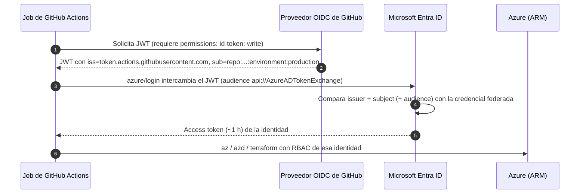

# 04 · GitHub Actions para desplegar en Azure

> Workflows seguros y reutilizables, autenticación OIDC con Microsoft Entra, environments,
> runners y equivalencias con Azure Pipelines.
> **Última revisión:** 24 de octubre de 2026.

[← Azure Pipelines YAML](03-azure-pipelines-yaml.md) · [Índice](../README.md) · [Siguiente: Estrategias de despliegue →](05-estrategias-de-despliegue.md)

---

## En esta guía

- [TL;DR](#tldr)
- [Anatomía de un workflow](#anatomía-de-un-workflow)
- [Eventos y su nivel de confianza](#eventos-y-su-nivel-de-confianza)
- [Autenticación OIDC con Azure (sin secretos)](#autenticación-oidc-con-azure-sin-secretos)
- [Environments y reglas de protección](#environments-y-reglas-de-protección)
- [Reutilización: reusable workflows, composite actions y plantillas](#reutilización-reusable-workflows-composite-actions-y-plantillas)
- [Runners](#runners)
- [Endurecimiento de workflows (hardening)](#endurecimiento-de-workflows-hardening)
- [Caché, artefactos y pasos en paralelo](#caché-artefactos-y-pasos-en-paralelo)
- [Acciones y comandos para cada servicio de Azure](#acciones-y-comandos-para-cada-servicio-de-azure)
- [Equivalencias con Azure Pipelines](#equivalencias-con-azure-pipelines)
- [Checklist](#checklist)
- [Referencias](#referencias)

---

## TL;DR

- **Nunca** guardes credenciales de Azure como secretos: usa **OIDC** (`permissions: id-token: write`
  y `azure/login@v3`) con credenciales federadas por **environment**.
- Repos creados después del **15-jul-2026** usan *subjects* **inmutables**
  (`repo:owner@<id>/repo@<id>:...`): tus credenciales federadas deben coincidir.
- `permissions: contents: read` por defecto, acciones **fijadas por SHA** (o *lockfile* de
  dependencias, *preview* 2026) y `persist-credentials: false`.
- Node 20 se eliminó de los runners el **23-sep-2026**: las acciones JavaScript corren en Node 24.
- Ejemplos completos: [`examples/github-actions/`](../examples/github-actions/).

---

## Anatomía de un workflow

```yaml
name: CD                                  # nombre visible
on:                                       # eventos
  push:
    branches: [main]
permissions:                              # permisos del GITHUB_TOKEN (mínimos)
  contents: read
concurrency:                              # evita despliegues simultáneos
  group: cd-${{ github.ref }}
  cancel-in-progress: false
jobs:
  deploy:
    runs-on: ubuntu-24.04                 # runner
    timeout-minutes: 20
    environment: production               # reglas de protección + secretos/variables
    permissions:
      id-token: write                     # token OIDC para Azure
      contents: read
    steps:
      - uses: actions/checkout@3d3c42e5aac5ba805825da76410c181273ba90b1 # v7.0.1
        with:
          persist-credentials: false
      - uses: azure/login@a641126d1b8aa4d1fa005f4f92df94a3a4c4c906 # v3.1.0
        with:
          client-id: ${{ vars.AZURE_CLIENT_ID }}
          tenant-id: ${{ vars.AZURE_TENANT_ID }}
          subscription-id: ${{ vars.AZURE_SUBSCRIPTION_ID }}
      - run: az group list -o table
```

| Concepto | Detalle importante |
| --- | --- |
| Jobs | Corren en paralelo salvo `needs:`; cada uno en un runner nuevo |
| `GITHUB_TOKEN` | Expira al terminar el job; sus permisos se definen con `permissions:` |
| Contextos | `github`, `env`, `vars`, `secrets`, `inputs`, `needs`, `steps`, `matrix`, `runner`, `job` |
| Expresiones | `${{ }}`; nunca interpoles entradas no confiables directamente en `run:` (ver hardening) |
| Límites | Job: 6 h en runners hospedados, 5 días en self-hosted; run: 35 días; matriz: 256 jobs; aprobaciones de environment: hasta 30 días; archivo de workflow: 500 KB |

---

## Eventos y su nivel de confianza

| Evento | Código que corre | Secretos | Riesgo |
| --- | --- | --- | --- |
| `push`, `workflow_dispatch`, `schedule` | Del repositorio | Sí | Bajo (requiere escritura) |
| `pull_request` (mismo repo) | Del PR | Sí | Medio |
| `pull_request` (fork) | Del PR | **No**; token de sólo lectura | Bajo para tus secretos |
| **`pull_request_target`** | De la **rama base**, con contexto privilegiado | Sí | **Alto** si haces checkout del código del PR ("pwn request") |
| `workflow_run` | De la rama por defecto | Sí | Alto si procesa artefactos del PR sin validar |
| `issue_comment` | De la rama por defecto | Sí | Alto: cualquiera puede comentar |
| `workflow_call` | Hereda del llamador | Según `secrets:` | Igual que el llamador |
| `merge_group` | Del *merge queue* | Sí | Bajo |

> [!CAUTION]
> `actions/checkout` **v7** bloquea por defecto hacer checkout del código de un *fork* en
> `pull_request_target` y `workflow_run`; sólo se permite con `allow-unsafe-pr-checkout: true`.
> Si crees necesitarlo, casi siempre la respuesta correcta es separar en dos workflows:
> `pull_request` (sin privilegios) + `workflow_run` que **sólo** lee resultados validados.

---

## Autenticación OIDC con Azure (sin secretos)



### 1. Crea la identidad

Prefiere una **identidad administrada asignada por el usuario** (no requiere permisos de
administrador de aplicaciones en Entra y vive junto a tus recursos) o una *app registration*.

```bash
# Identidad para producción
az identity create -g rg-identidades -n id-github-miapp-prod
CLIENT_ID=$(az identity show -g rg-identidades -n id-github-miapp-prod --query clientId -o tsv)
PRINCIPAL_ID=$(az identity show -g rg-identidades -n id-github-miapp-prod --query principalId -o tsv)

# RBAC mínimo: sólo el resource group de la app
az role assignment create --assignee-object-id "$PRINCIPAL_ID" --assignee-principal-type ServicePrincipal \
  --role "Website Contributor" \
  --scope "$(az group show -n rg-miapp-prod --query id -o tsv)"
```

### 2. Crea la credencial federada con el *subject* correcto

| Caso | *Subject* clásico | *Subject* inmutable (repos nuevos desde 15-jul-2026 u *opt-in*) |
| --- | --- | --- |
| Job con `environment: production` | `repo:contoso/miapp:environment:production` | `repo:contoso@5544123/miapp@821093847:environment:production` |
| Push a `main` sin environment | `repo:contoso/miapp:ref:refs/heads/main` | `repo:contoso@5544123/miapp@821093847:ref:refs/heads/main` |
| Pull request | `repo:contoso/miapp:pull_request` | `repo:contoso@5544123/miapp@821093847:pull_request` |
| Tag | `repo:contoso/miapp:ref:refs/tags/v1.2.0` | `repo:contoso@5544123/miapp@821093847:ref:refs/tags/v1.2.0` |

```bash
# IDs numéricos inmutables del owner y del repo
gh api repos/contoso/miapp --jq '"owner_id=\(.owner.id) repo_id=\(.id)"'

az identity federated-credential create \
  --identity-name id-github-miapp-prod -g rg-identidades \
  --name github-production \
  --issuer https://token.actions.githubusercontent.com \
  --subject "repo:contoso@5544123/miapp@821093847:environment:production" \
  --audiences api://AzureADTokenExchange
```

> [!IMPORTANT]
> **Subjects inmutables (2026).** GitHub agregó los IDs del owner y del repositorio al `sub` para que
> renombrar, transferir o recrear un repositorio no herede la confianza. Aplica por defecto a repos
> creados después del 15 de julio de 2026 y a repos renombrados o transferidos después de esa fecha;
> los anteriores pueden activarlo (*opt-in*) a nivel organización o repositorio. Para migrar sin
> downtime: crea la credencial nueva junto a la vieja, activa el formato inmutable, valida y borra la
> anterior.

**Límites y alternativas**

- Hasta **20 credenciales federadas por identidad**; si necesitas más combinaciones, usa
  *flexible federated identity credentials* (*preview*): expresiones como
  `claims['sub'] matches 'repo:contoso@5544123/miapp@821093847:environment:*'`, que para GitHub
  **deben** validar también `repository_id` y/o `repository_owner_id`.
- Puedes personalizar el *subject* del token (API de OIDC de GitHub) para incluir, por ejemplo,
  `job_workflow_ref` y así confiar sólo en un **reusable workflow** central de despliegue.

### 3. Usa el login en el workflow

```yaml
permissions:
  id-token: write
  contents: read

steps:
  - uses: azure/login@a641126d1b8aa4d1fa005f4f92df94a3a4c4c906 # v3.1.0
    with:
      client-id: ${{ vars.AZURE_CLIENT_ID }}        # variables, no secretos: no son sensibles
      tenant-id: ${{ vars.AZURE_TENANT_ID }}
      subscription-id: ${{ vars.AZURE_SUBSCRIPTION_ID }}
  - run: az account show -o table
```

Para Terraform no necesitas `azure/login`: exporta `ARM_USE_OIDC=true`, `ARM_CLIENT_ID`,
`ARM_TENANT_ID` y `ARM_SUBSCRIPTION_ID`; el provider pide el token OIDC por su cuenta
(ver [`infra-terraform.yml`](../examples/github-actions/infra-terraform.yml)).

> [!WARNING]
> Los PRs de **forks** no reciben `id-token: write`: no podrán autenticarse en Azure (y está bien).
> Si el login falla con `AADSTS700213` o `AADSTS7002138`, el *subject* del token no coincide con
> ninguna credencial federada (la comparación distingue mayúsculas): copia el *subject claim* que
> `azure/login` muestra en el log y revisa environment vs. rama y el formato inmutable. Ver
> [Troubleshooting](10-troubleshooting.md#identidad-y-autenticación-entra-id-oidc-wif).

---

## Environments y reglas de protección

Un **environment** agrupa reglas de protección, secretos y variables de un destino.

| Regla | Uso |
| --- | --- |
| **Required reviewers** | Hasta 6 personas/equipos; opción de impedir que quien disparó apruebe |
| **Wait timer** | Espera de hasta 30 días (p. ej. *bake time* entre rings) |
| **Deployment branches and tags** | Sólo `main` o `release/*` pueden desplegar a producción |
| **Custom deployment protection rules** | GitHub Apps que aprueban/rechazan (Azure Monitor, ServiceNow, Datadog, tus propios gates) |
| **Allow administrators to bypass** | Desactívalo en producción |
| Secretos y variables del environment | Sólo disponibles para jobs que referencian el environment, **después** de pasar las reglas |

Patrón recomendado: **misma variable, distinto valor por environment**. Define `AZURE_CLIENT_ID`
a nivel repo (identidad de CI) y sobrescríbela en `production` (identidad de producción con su
propia credencial federada). Así ningún job fuera del environment puede usar la identidad de producción.

---

## Reutilización: reusable workflows, composite actions y plantillas

| Mecanismo | Qué es | Úsalo para | Límites |
| --- | --- | --- | --- |
| **Reusable workflow** (`on: workflow_call`) | Un workflow completo (jobs, environments, runners) que otro invoca | Golden paths de despliegue; estandarizar CD entre repos | Hasta **10 niveles** de anidación y **50** workflows reutilizables únicos por workflow llamador |
| **Composite action** | Varios steps empaquetados como acción | Secuencias repetidas dentro de un job (setup + cache + build) | No puede declarar jobs ni environments |
| **Workflow templates** | Archivos sugeridos en el repo `.github` de la organización | Arranque rápido de repos nuevos | Son una copia: no se actualizan solos |
| **Rulesets con workflows requeridos** | Exigen que ciertos checks/workflows pasen | Gobierno: escaneo obligatorio en toda la organización | Requiere plan Team/Enterprise según la función |

```yaml
# Llamada a un reusable workflow (ver examples/github-actions/cd-webapp.yml)
jobs:
  deploy-prod:
    uses: contoso/platform-workflows/.github/workflows/deploy-webapp.yml@v4.2.0   # fija versión
    permissions:
      id-token: write
      contents: read
    with:
      environment: production
      app-name: app-miapp-prod
    secrets: inherit        # evita esto si puedes: pasa sólo lo necesario
```

> [!TIP]
> Los permisos del `GITHUB_TOKEN` **sólo pueden reducirse** al bajar por la cadena de reusable
> workflows: el job que llama debe otorgar `id-token: write` si el reusable lo necesita.

---

## Runners

### Imágenes hospedadas por GitHub (octubre de 2026)

| Etiqueta | SO / arquitectura | Notas |
| --- | --- | --- |
| `ubuntu-latest`, `ubuntu-24.04` | Ubuntu 24.04 x64 | Default recomendado (fíjalo explícito) |
| `ubuntu-26.04` | Ubuntu 26.04 x64 | GA 2026 |
| `ubuntu-24.04-arm`, `ubuntu-26.04-arm` | Linux arm64 | Builds nativos ARM (también en repos privados) |
| `ubuntu-22.04` | Ubuntu 22.04 | En retiro: totalmente sin soporte desde abril de 2027 |
| `ubuntu-slim` | Contenedor Ubuntu, 1 vCPU | Tareas ligeras (etiquetas, notificaciones); **timeout de 15 min**, sin Docker-in-Docker |
| `windows-latest`, `windows-2025`, `windows-2025-vs2026` | Windows Server 2025 + VS 2026 | |
| `windows-2022` | Windows Server 2022 | |
| `windows-11-arm`, `windows-11-vs2026-arm` | Windows 11 arm64 | |
| `macos-latest`, `macos-26` | macOS 26 arm64 (M1) | `-xlarge` disponible como *larger runner* |
| `macos-15`, `macos-15-intel`, `macos-26-intel` | macOS 15 / Intel | |
| `macos-14` | macOS 14 | **Obsoleta** |

Especificaciones estándar: **repos públicos** Linux/Windows con 4 vCPU y 16 GB; **repos privados**
con 2 vCPU y 8 GB; macOS arm64 con 3 vCPU (M1) y 7 GB.

| Opción | Cuándo | Notas |
| --- | --- | --- |
| Estándar hospedado | Por defecto | Precios reducidos hasta 39 % desde el 1-ene-2026 |
| **Larger runners** | Más CPU/RAM/GPU, IP estáticas, **red privada de Azure** (VNet injection) | Plan Team/Enterprise; facturación por minuto |
| **Imágenes personalizadas** | Herramientas preinstaladas en larger runners (`jobs.<id>.snapshot` genera la imagen) | Reduce minutos de setup |
| **Self-hosted** efímero / **ARC** (*runner scale sets* en Kubernetes) | Hardware propio, red on-premises | Un job por runner, nunca para repos públicos. El cargo de plataforma anunciado para self-hosted se **pospuso** (verifica la página de facturación) |

---

## Endurecimiento de workflows (hardening)

1. **Permisos mínimos**: en *Settings → Actions → General* configura el `GITHUB_TOKEN` como
   **read-only** por defecto, y declara `permissions:` en cada workflow/job.
2. **Dependencias inmutables**:
   - Fija cada acción por **SHA completo** con el tag en comentario (Dependabot sabe actualizarlo).
   - Mejor aún (2026, *public preview*): **lockfile de dependencias** `.github/workflows/actions.lock`
     generado con `gh actions-lock`, que fija también las dependencias transitivas y verifica la
     identidad del repositorio de origen en tiempo de ejecución.
   - Política de organización: **acciones permitidas** (lista explícita), **exigir pinning por SHA**
     y bloquear acciones concretas.
   - Prefiere acciones con **releases inmutables**.
3. **Inyección de scripts**: nunca uses `${{ github.event.pull_request.title }}` (u otra entrada
   controlable) dentro de `run:`. Pásala por `env:` y cítala:

   ```yaml
   - name: Seguro
     env:
       TITLE: ${{ github.event.pull_request.title }}
     run: echo "Título: $TITLE"
   ```

4. **`persist-credentials: false`** en `actions/checkout` salvo que un paso posterior necesite
   hacer push.
5. **OIDC en vez de secretos**; si un secreto es inevitable, en el environment, nunca en el repo, y
   con rotación.
6. **Atestaciones de procedencia** (`actions/attest@v4`) y verificación antes de desplegar
   (`gh attestation verify`). En repos privados requiere GitHub Enterprise Cloud.
7. **Escanea tus workflows**: CodeQL analiza el lenguaje `actions` (inyecciones, `pull_request_target`
   inseguro); OpenSSF Scorecard evalúa prácticas de la cadena de suministro.
8. **Caché**: desde 2026 los disparadores de baja confianza (`pull_request_target`, `issue_comment`,
   `workflow_run`…) sólo **leen** la caché de la rama por defecto; usa `cache-mode: read` en jobs que
   procesan entradas no confiables y no lo cambies a `write` sin entender el riesgo de *cache poisoning*.
9. **Runners self-hosted** efímeros (un job por runner) y aislados de redes sensibles.

> [!CAUTION]
> **Lecciones 2025–2026.** En `tj-actions/changed-files` (mar-2025), `aquasecurity/trivy-action` y
> `setup-trivy` (mar-2026) y `actions-cool/*` (may-2026), atacantes **movieron los tags** de acciones
> populares a commits maliciosos que robaban secretos de los runners. Los workflows fijados por SHA a
> versiones sanas, o protegidos por releases inmutables, no ejecutaron el código malicioso. Si un
> workflow tuyo corrió una versión comprometida: **rota todos los secretos** a los que tuvo acceso y
> revisa los logs de esa ventana.

---

## Caché, artefactos y pasos en paralelo

| Necesidad | Herramienta | Notas |
| --- | --- | --- |
| Caché de dependencias | `cache:` integrado en `actions/setup-*` o `actions/cache@v6` | 10 GB por repo por defecto (ampliable con almacenamiento de pago); expulsión tras 7 días sin uso |
| Pasar archivos entre jobs | `actions/upload-artifact@v7` / `download-artifact@v8` | Retención configurable (`retention-days`); el upload devuelve el digest |
| Paquetes | GitHub Packages o Azure Artifacts | Autentica con OIDC/`GITHUB_TOKEN`, no con PATs |
| Imágenes | Azure Container Registry (`az acr login` tras `azure/login`) | Despliega por **digest** |

**Pasos en segundo plano y en paralelo (2026).** Un job puede lanzar pasos con `background: true` y
sincronizarlos con `wait`, `wait-all` o `cancel`, o agrupar pasos con `parallel:` (máximo 10
pasos concurrentes). Útil para levantar dependencias durante las pruebas o compilar componentes a la vez:

```yaml
steps:
  - name: Base de datos de prueba
    id: db
    run: docker run --rm -p 5432:5432 -e POSTGRES_PASSWORD=test postgres:17
    background: true
  - name: Pruebas de integración
    run: dotnet test tests/MiApp.IntegrationTests
  - name: Detener la base de datos
    cancel: db
```

---

## Acciones y comandos para cada servicio de Azure

| Destino | Acción / comando recomendado | Ejemplo |
| --- | --- | --- |
| App Service / Web App for Containers | `azure/webapps-deploy@v3` (o `az webapp deploy`) + `az webapp deployment slot swap` | [cd-webapp.yml](../examples/github-actions/cd-webapp.yml) |
| Azure Functions | `azure/functions-action@v1` (en Flex Consumption: `sku: flexconsumption`, `remote-build` opcional) | — |
| Container Apps | `az containerapp update` / `revision label` / `ingress traffic set` (o `azure/container-apps-deploy-action@v2`) | [cd-containerapps.yml](../examples/github-actions/cd-containerapps.yml) |
| AKS | `azure/aks-set-context@v5` + `azure/k8s-deploy@v7`, o **GitOps** (Flux/Argo CD) | [06 · AKS](06-destinos-de-despliegue-azure.md#azure-kubernetes-service-aks) |
| Static Web Apps | `Azure/static-web-apps-deploy@v1` (*preview environments* por PR) | — |
| Bicep / ARM | `azure/bicep-deploy@v2` (deployments y **deployment stacks**, what-if) | [infra-bicep.yml](../examples/github-actions/infra-bicep.yml) |
| Terraform | `hashicorp/setup-terraform@v4` + variables `ARM_*` con OIDC | [infra-terraform.yml](../examples/github-actions/infra-terraform.yml) |
| Azure Developer CLI | `azd pipeline config` genera el workflow y la credencial federada | — |
| CLI genérico | `azure/cli@v3` o `run: az ...` tras `azure/login` | — |

---

## Equivalencias con Azure Pipelines

| Azure Pipelines | GitHub Actions |
| --- | --- |
| Pipeline (`azure-pipelines.yml`) | Workflow (`.github/workflows/*.yml`) |
| Stage | Grupo de jobs con `needs:` (no hay "stage" nativo) |
| Job / deployment job | Job (con `environment:` para despliegues) |
| Step / task (`Task@N`) | Step (`run:` / `uses: owner/action@sha`) |
| Template de steps | Composite action |
| Template de jobs/stages, `extends` | Reusable workflow; rulesets con workflows requeridos |
| Variables / variable groups | `env:`, variables de repo/org/environment (`vars`) |
| Variable secreta / Key Vault | Secretos de repo/org/environment (o Key Vault vía OIDC) |
| Service connection ARM con WIF | Credencial federada + `azure/login` (OIDC) |
| Environment + approvals and checks | Environment + protection rules (revisores, wait timer, ramas, reglas personalizadas) |
| Agent pool / Microsoft-hosted / MDP | Runner groups / GitHub-hosted / larger runners con red privada |
| `$(Build.BuildNumber)` | `${{ github.run_number }}` / `${{ github.run_id }}` |
| `condition: succeeded()` | `if: success()` |
| `dependsOn` | `needs` |
| Pipeline artifacts | `upload-artifact` / `download-artifact` |
| `Cache@2` | `actions/cache` o `cache:` de `setup-*` |
| Resource trigger (pipeline completado) | `workflow_run` |
| Exclusive lock | `concurrency:` |

---

## Checklist

- [ ] `permissions` mínimos declarados; `GITHUB_TOKEN` read-only por defecto en la organización.
- [ ] Todas las acciones fijadas por SHA (o lockfile); Dependabot para `github-actions` activado.
- [ ] Cero secretos de Azure: OIDC con credenciales federadas por environment (formato de *subject* correcto).
- [ ] Environments `production` con revisores, ramas permitidas y sin bypass de administradores.
- [ ] Ningún `pull_request_target`/`workflow_run` que ejecute código de forks.
- [ ] `timeout-minutes` en todos los jobs y `concurrency` en despliegues.
- [ ] Atestación de artefactos/imágenes y verificación antes de desplegar a producción.
- [ ] Runners fijados (`ubuntu-24.04`), con plan para probar `ubuntu-26.04`.

---

## Referencias

- [Workflow syntax](https://docs.github.com/actions/reference/workflows-and-actions/workflow-syntax)
- [OpenID Connect en GitHub Actions](https://docs.github.com/actions/concepts/security/openid-connect) y [referencia de claims](https://docs.github.com/actions/reference/security/oidc)
- [Uso seguro de GitHub Actions](https://docs.github.com/actions/reference/security/secure-use)
- [Workflow dependency lockfiles](https://docs.github.com/actions/concepts/security/workflow-dependency-lockfiles)
- [Deployments and environments](https://docs.github.com/actions/reference/workflows-and-actions/deployments-and-environments)
- [Runners hospedados por GitHub](https://docs.github.com/actions/reference/runners/github-hosted-runners) y [runner-images](https://github.com/actions/runner-images)
- [Azure Login Action](https://github.com/Azure/login)
- [Migrar credenciales federadas a subjects inmutables (Microsoft Entra)](https://learn.microsoft.com/entra/workload-id/workload-identities-github-immutable-subjects)
- [Límites de GitHub Actions](https://docs.github.com/actions/reference/limits)

[← Azure Pipelines YAML](03-azure-pipelines-yaml.md) · [Índice](../README.md) · [Siguiente: Estrategias de despliegue →](05-estrategias-de-despliegue.md)
