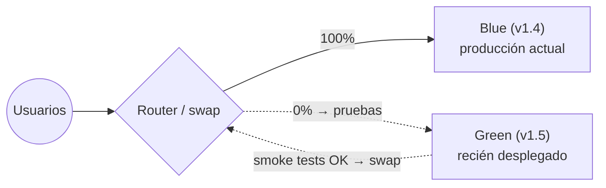
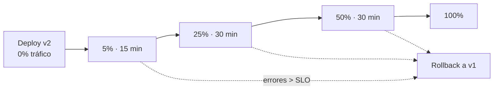
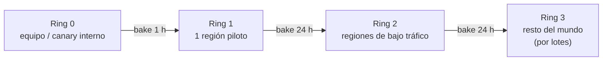
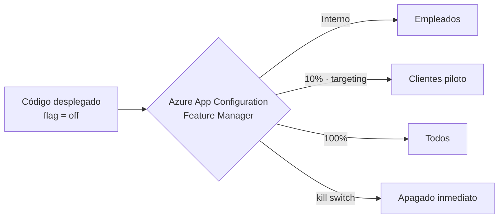
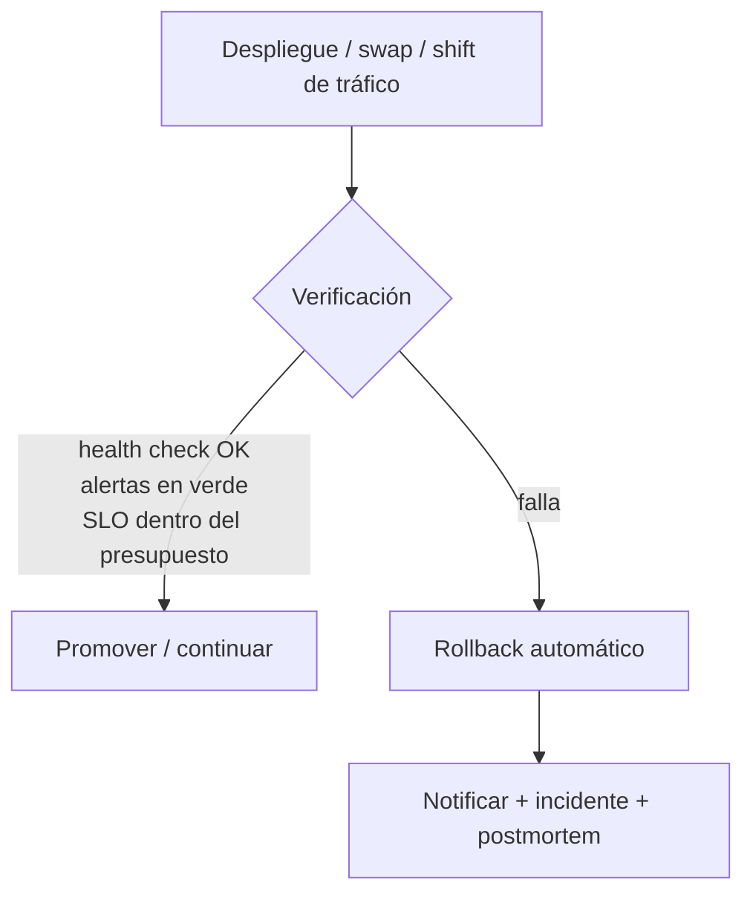

# 05 · Estrategias de despliegue

> Cómo llevar cambios a producción sin downtime y con un rollback de segundos: blue-green, canary,
> rings, feature flags y cambios de base de datos, aterrizados en servicios de Azure.
> **Última revisión:** 24 de octubre de 2026.

[← GitHub Actions](04-github-actions-azure.md) · [Índice](../README.md) · [Siguiente: Destinos de despliegue en Azure →](06-destinos-de-despliegue-azure.md)

---

## En esta guía

- [TL;DR](#tldr)
- [Comparativa de estrategias](#comparativa-de-estrategias)
- [Blue-green](#blue-green)
- [Canary y despliegue progresivo](#canary-y-despliegue-progresivo)
- [Rings y Safe Deployment Practices](#rings-y-safe-deployment-practices)
- [Feature flags: separar desplegar de liberar](#feature-flags-separar-desplegar-de-liberar)
- [Cambios de base de datos sin downtime](#cambios-de-base-de-datos-sin-downtime)
- [Verificación y rollback automáticos](#verificación-y-rollback-automáticos)
- [Matriz por servicio de Azure](#matriz-por-servicio-de-azure)
- [Checklist de un despliegue a producción](#checklist-de-un-despliegue-a-producción)
- [Referencias](#referencias)

---

## TL;DR

- **Desplegar ≠ liberar**: despliega código apagado detrás de *feature flags* y libéralo por
  porcentaje o audiencia.
- En Azure, el blue-green "gratis" está en **slots de App Service** y **revisiones de Container Apps**;
  el canary avanzado en **AKS** (Gateway API, malla de servicios, Argo Rollouts/Flagger) y en
  **Front Door** entre regiones.
- Todo despliegue progresivo necesita **señales de salud objetivas** (errores, latencia, saturación) y
  un **rollback automático** probado.
- Las migraciones de base de datos deben ser **compatibles hacia atrás** (*expand/contract*).

---

## Comparativa de estrategias

| Estrategia | Cómo funciona | Downtime | Rollback | Costo extra | Complejidad |
| --- | --- | --- | --- | --- | --- |
| **Recreate** | Apaga la versión vieja y levanta la nueva | Sí | Lento (redesplegar) | Ninguno | Baja |
| **Rolling** | Reemplaza instancias por lotes | No (si hay *readiness probes*) | Medio (otro rolling) | Bajo | Baja |
| **Blue-green** | Dos ambientes idénticos; se cambia el tráfico de golpe | No | **Inmediato** (regresar el tráfico) | Doble capacidad durante el cambio | Media |
| **Canary** | Un % pequeño del tráfico va a la versión nueva y crece si las métricas son buenas | No | Inmediato (tráfico a 0 %) | Bajo | Alta (requiere métricas) |
| **Rings** | Canary por audiencias/regiones: interno → piloto → general | No | Por ring | Bajo | Alta |
| **A/B testing** | Variantes para medir comportamiento de negocio | No | Apagar variante | Bajo | Media |
| **Shadow / dark launch** | Se duplica tráfico real hacia la versión nueva sin afectar respuestas | No | N/A | Alto | Alta |
| **Feature flags** | El código ya está desplegado; se activa por flag | No | **Instantáneo** (apagar flag) | Bajo | Media (deuda de flags) |

---

## Blue-green

| En Azure | Cómo se implementa |
| --- | --- |
| **App Service** | Desplegar al slot `staging` → *warm-up* → **swap** con producción. Rollback = otro swap. Ver [`webapp-ci-cd.yml`](../examples/azure-pipelines/webapp-ci-cd.yml) |
| **Container Apps** | Modo de revisiones **múltiple** + etiquetas `blue`/`green` + `az containerapp ingress traffic set --label-weight`. Ver [`cd-containerapps.yml`](../examples/github-actions/cd-containerapps.yml) |
| **AKS** | Dos `Deployment` (`app-blue`, `app-green`) y cambiar el selector del `Service` o el `backendRef` de un `HTTPRoute` (Gateway API) |
| **Multi-región / stamps** | Azure Front Door o Traffic Manager con pesos entre *backends* |

**Detalles de App Service que marcan la diferencia**

- Los slots requieren plan **Standard, Premium o Isolated**; no cuestan extra (comparten el plan).
- El swap **calienta** cada instancia antes de cambiar el ruteo: configura
  `WEBSITE_SWAP_WARMUP_PING_PATH=/healthz` y `WEBSITE_SWAP_WARMUP_PING_STATUSES=200` (o
  `applicationInitialization` en Windows).
- **Slot settings** ("sticky"): valores que se quedan en el slot (p. ej. un flag
  `ES_STAGING=true`). Todo lo demás viaja con el código en el swap.
- **Swap with preview** (multi-fase): aplica la configuración de producción al slot origen, te deja
  validar y luego completa o cancela. No funciona si la autenticación del sitio está habilitada.
- **Auto swap** no está soportado en Linux ni en contenedores.
- **Testing in production**: enruta un % del tráfico de producción a un slot (`Traffic %`); los
  usuarios quedan fijados por la cookie `x-ms-routing-name`.

---

## Canary y despliegue progresivo

| Plataforma | Herramienta | Señales para avanzar/abortar |
| --- | --- | --- |
| Container Apps | Pesos por revisión o etiqueta (`--revision-weight`, `--label-weight`) | Application Insights / Azure Monitor (tasa de errores, latencia p95) |
| AKS | `KubernetesManifest@1` (`strategy: canary`), Gateway API (`HTTPRoute` con `weight`), **Istio** (add-on de malla), **Argo Rollouts** o **Flagger** con *analysis templates* | Managed Prometheus, Container Insights |
| App Service | `Traffic %` hacia un slot | Application Insights |
| Front Door | Pesos por *origin group* | Métricas de Front Door + App Insights por región |
| Functions (Flex Consumption) | *Site update strategy* **Rolling update** (sin slots en Flex) | Errores de ejecución |

> [!TIP]
> Un canary sin métricas es sólo un despliegue lento. Define antes **qué métrica**, **qué umbral** y
> **cuánto tiempo** (bake time) decide el avance, y automatiza la decisión (check *Query Azure Monitor
> alerts* en Azure Pipelines, regla de protección personalizada en GitHub, o el análisis de Argo Rollouts).

---

## Rings y Safe Deployment Practices

Microsoft despliega Azure con **Safe Deployment Practices (SDP)**: cada cambio avanza por anillos con
tiempo de observación y criterios de salud, y se detiene automáticamente ante anomalías.

Cómo modelarlo:

- **Azure Pipelines**: un stage por ring/región con la propiedad `group` (p. ej. `group: Ring2\Europa`),
  environments con checks (aprobación, *Query Azure Monitor alerts*, horario) y la vista **Stages**
  para ver qué versión está en cada ring.
- **GitHub Actions**: un job por ring con su `environment` (*wait timer* como bake time y revisores
  sólo en los rings de mayor alcance).
- Despliega **una región a la vez** dentro de un ring, nunca todas en paralelo.

---

## Feature flags: separar desplegar de liberar

- **Azure App Configuration** ofrece *feature management* con filtros (porcentaje, *targeting* por
  usuario/grupo, ventana de tiempo) y **variantes** para experimentos; las librerías
  `Microsoft.FeatureManagement` (.NET), y equivalentes para JS, Python, Java y Go, los evalúan.
  Considera **OpenFeature** como API neutral.
- **Usos**: liberar gradualmente, *kill switches*, pruebas en producción, *trunk-based development*
  con trabajo incompleto apagado.
- **Higiene**: cada flag tiene dueño y fecha de retiro. Los flags de liberación viven semanas, no años.

---

## Cambios de base de datos sin downtime

Durante un swap, un canary o un rollback, **dos versiones de la app conviven con el mismo esquema**.
Por eso los cambios de esquema se hacen en varias fases (*expand / contract*):

| Fase | Release | Cambio de esquema | Código |
| --- | --- | --- | --- |
| 1. Expand | N | Agregar columna/tabla nueva (nullable o con default) | Escribe en vieja **y** nueva; lee de la vieja |
| 2. Migrar | N+1 | *Backfill* de datos | Lee de la nueva (con *fallback*) |
| 3. Contract | N+2 | Eliminar la columna vieja | Sólo usa la nueva |

Reglas:

- **Nunca** renombres o borres columnas en el mismo release que cambia el código que las usa.
- Ejecuta las migraciones como **paso separado y explícito** antes del swap/canary (EF Core
  *migration bundles*, `sqlpackage` con dacpac, Flyway, Liquibase, DbUp), con una identidad que
  sólo tenga permisos de DDL durante ese paso.
- Prueba las migraciones contra una copia realista (anonimizada) en staging.
- El rollback de la app debe funcionar **sin** revertir el esquema.

---

## Verificación y rollback automáticos

| Señal | Cómo obtenerla |
| --- | --- |
| Health endpoint | `/healthz` (dependencias críticas) y `/livez` (proceso vivo); *health check* de App Service y *probes* de Kubernetes/Container Apps |
| Pruebas sintéticas | *Availability tests* de Application Insights, Playwright programado |
| Errores y latencia | Alertas de Azure Monitor sobre App Insights (tasa de fallos, p95), Managed Prometheus en AKS |
| Negocio | Métricas propias (pedidos/min, pagos fallidos) con alertas |

**Rollback por plataforma**

| Plataforma | Rollback | Tiempo típico |
| --- | --- | --- |
| App Service (slots) | Swap de regreso | Segundos a 1–2 min |
| Container Apps | Tráfico a la revisión/etiqueta anterior | Segundos |
| AKS | `kubectl rollout undo`, `helm rollback`, abortar el Rollout, o revertir el commit en GitOps | Segundos a minutos |
| Functions (Flex) | Redesplegar el paquete anterior (guárdalo) | Minutos |
| Feature flag | Apagar el flag | Inmediato |
| Infraestructura | **Roll-forward** con un nuevo commit (el "rollback" de IaC rara vez es seguro) | Variable |

> [!IMPORTANT]
> Un rollback que nunca se ha ejecutado no existe. Practícalo en staging (y en *game days*), mide cuánto
> tarda y documenta cuándo conviene *roll-forward* (por ejemplo, después de una migración de datos).

---

## Matriz por servicio de Azure

| Servicio | Rolling | Blue-green | Canary | Rollback nativo | Dónde profundizar |
| --- | --- | --- | --- | --- | --- |
| App Service | ✔ (por instancias) | ✔ **slots + swap** | ✔ `Traffic %` | Swap | [06 · App Service](06-destinos-de-despliegue-azure.md#azure-app-service) |
| Functions (Premium/Dedicated) | — | ✔ slots | — | Swap | [06 · Functions](06-destinos-de-despliegue-azure.md#azure-functions) |
| Functions (Flex Consumption) | ✔ *rolling update* | ✘ (sin slots) | — | Redeploy | [06 · Functions](06-destinos-de-despliegue-azure.md#azure-functions) |
| Container Apps | ✔ (modo single) | ✔ **revisiones + etiquetas** | ✔ pesos | Tráfico | [06 · Container Apps](06-destinos-de-despliegue-azure.md#azure-container-apps) |
| AKS | ✔ `RollingUpdate` | ✔ Service/Gateway | ✔ Gateway API, Istio, Argo Rollouts | `rollout undo`, GitOps | [06 · AKS](06-destinos-de-despliegue-azure.md#azure-kubernetes-service-aks) |
| Static Web Apps | — | ✔ *preview environments* | — | Redeploy | [06 · Static Web Apps](06-destinos-de-despliegue-azure.md#azure-static-web-apps) |
| VM / VMSS | ✔ *rolling upgrades* | Con dos VMSS + balanceador | Con pesos en Front Door | Imagen anterior | [06 · VMs](06-destinos-de-despliegue-azure.md#máquinas-virtuales-y-vmss) |

---

## Checklist de un despliegue a producción

- [ ] Artefacto inmutable (zip o imagen por digest) con procedencia verificada.
- [ ] Migraciones de BD compatibles hacia atrás aplicadas y verificadas.
- [ ] Ventana de cambio y aprobaciones cumplidas (si aplican).
- [ ] Despliegue a slot/revisión sin tráfico + smoke tests.
- [ ] Cambio de tráfico progresivo o swap con *warm-up*.
- [ ] Verificación automática (health, alertas, SLO) durante el *bake time*.
- [ ] Rollback automático listo y probado.
- [ ] Anotación de despliegue en Application Insights / dashboard y notificación al equipo.

---

## Referencias

- [App Service: deployment slots](https://learn.microsoft.com/azure/app-service/deploy-staging-slots) y [buenas prácticas de despliegue](https://learn.microsoft.com/azure/app-service/deploy-best-practices)
- [Container Apps: blue-green](https://learn.microsoft.com/azure/container-apps/blue-green-deployment), [traffic splitting](https://learn.microsoft.com/azure/container-apps/traffic-splitting) y [deployment labels](https://learn.microsoft.com/azure/container-apps/deployment-labels)
- [Functions Flex Consumption: site update strategies](https://learn.microsoft.com/azure/azure-functions/flex-consumption-site-updates)
- [Azure App Configuration: feature management](https://learn.microsoft.com/azure/azure-app-configuration/feature-management-overview)
- [Safe deployment practices (Azure Well-Architected)](https://learn.microsoft.com/azure/well-architected/operational-excellence/safe-deployments)
- [Argo Rollouts](https://argoproj.github.io/rollouts/) · [Flagger](https://flagger.app/) · [Gateway API](https://gateway-api.sigs.k8s.io/)

[← GitHub Actions](04-github-actions-azure.md) · [Índice](../README.md) · [Siguiente: Destinos de despliegue en Azure →](06-destinos-de-despliegue-azure.md)
