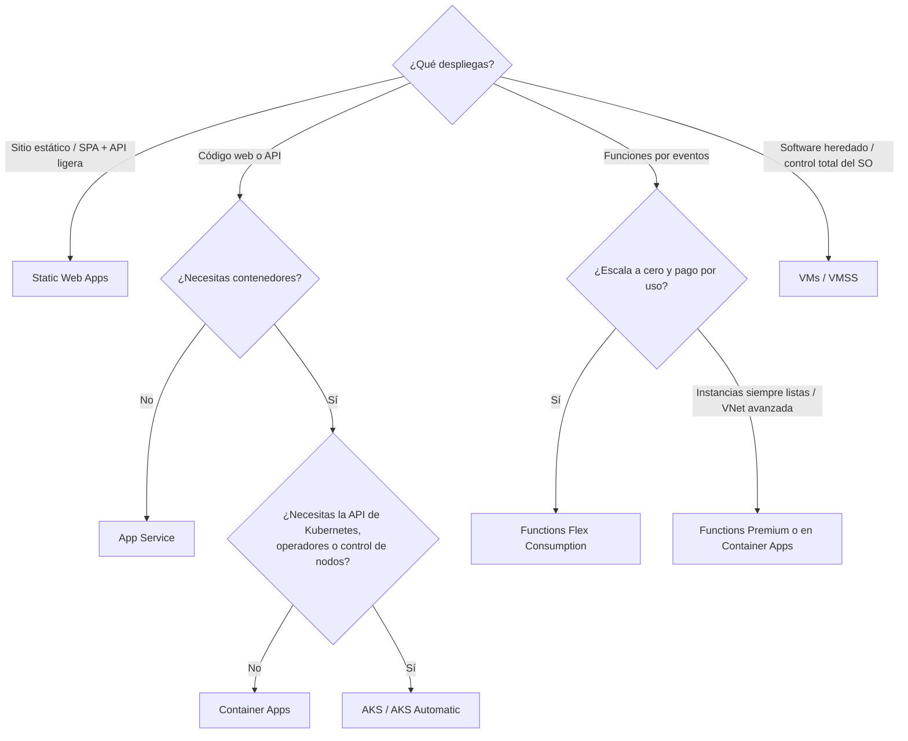
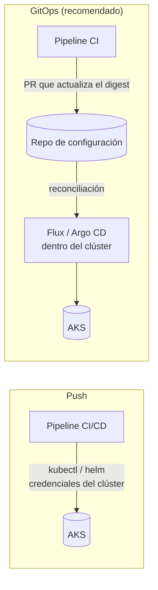

# 06 · Destinos de despliegue en Azure

> Qué servicio de cómputo elegir y cómo desplegar en cada uno de forma segura: App Service,
> Functions, Container Apps, AKS, Static Web Apps, VMs y Container Registry.
> **Última revisión:** 24 de octubre de 2026.

[← Estrategias de despliegue](05-estrategias-de-despliegue.md) · [Índice](../README.md) · [Siguiente: Infraestructura como código →](07-infraestructura-como-codigo.md)

---

## En esta guía

- [TL;DR](#tldr)
- [¿Qué servicio elijo?](#qué-servicio-elijo)
- [Azure App Service](#azure-app-service)
- [Azure Functions](#azure-functions)
- [Azure Container Apps](#azure-container-apps)
- [Azure Kubernetes Service (AKS)](#azure-kubernetes-service-aks)
- [Azure Static Web Apps](#azure-static-web-apps)
- [Máquinas virtuales y VMSS](#máquinas-virtuales-y-vmss)
- [Azure Container Registry](#azure-container-registry)
- [Azure Developer CLI (azd)](#azure-developer-cli-azd)
- [Referencias](#referencias)

---

## TL;DR

- **Web/API sin contenedores** → App Service (slots para cero downtime).
- **Eventos y serverless** → Functions en **Flex Consumption** (el modelo *in-process* de .NET pierde
  soporte el **10-nov-2026**).
- **Contenedores sin operar Kubernetes** → Container Apps (revisiones, escalado a cero, KEDA, Dapr).
- **Plataforma Kubernetes completa** → AKS (considera **AKS Automatic**) con **GitOps** y
  **Gateway API** (el add-on NGINX de app routing pierde parches en **noviembre de 2026**).
- **Frontends estáticos/SPA** → Static Web Apps.
- En todos: **identidad administrada**, cero credenciales en el pipeline y *health checks*.

---

## ¿Qué servicio elijo?



| Servicio | Unidad de despliegue | Escalado | Estrategias nativas | Ideal para |
| --- | --- | --- | --- | --- |
| App Service | Zip / contenedor | Manual o autoescala por reglas; instancias | Slots, swap, % de tráfico | APIs y webs .NET, Java, Node, Python, PHP |
| Functions (Flex) | Paquete zip | Por eventos, a cero, hasta 1,000 instancias | *Rolling update* | Integraciones, procesamiento por eventos |
| Container Apps | Imagen | KEDA (HTTP, colas, cron…), a cero | Revisiones, etiquetas, pesos | Microservicios, workers, jobs |
| AKS | Manifiestos / Helm / Kustomize | HPA, KEDA, Karpenter (NAP) | Rolling, canary, blue-green vía Gateway/mesh | Plataformas multi-equipo, cargas complejas |
| Static Web Apps | Build estático | Global (CDN) | *Preview environments* | Frontends y SPAs |
| VMs / VMSS | Imagen o scripts | VMSS autoescala | Rolling upgrades | Legado, software de terceros |

---

## Azure App Service

**Despliegue recomendado (2026)**

- Paquete **zip** con *OneDeploy*/*ZipDeploy* (tareas `AzureWebApp@1`, `AzureRmWebAppDeployment@5`,
  acción `azure/webapps-deploy@v3`, o `az webapp deploy`), o **contenedor** desde ACR con identidad
  administrada. Los **sidecars** permiten agregar contenedores auxiliares (OpenTelemetry collector, caché).
- **Deshabilita la autenticación básica** (SCM y FTP): los despliegues usan Microsoft Entra.
- **Slots** (`staging`) + swap con *warm-up* (ver [estrategias](05-estrategias-de-despliegue.md#blue-green)).
- **Health check** (`/healthz`) para que la plataforma retire instancias enfermas.
- Planes: Premium v3 (`P0v3` es el Premium más económico) y Premium v4; los slots requieren
  Standard o superior.

```bash
# Desplegar a un slot y hacer swap (CLI autenticada con OIDC/identidad federada)
az webapp deploy -g rg-miapp-prod -n app-miapp-prod --slot staging \
  --src-path webapp.zip --type zip
az webapp deployment slot swap -g rg-miapp-prod -n app-miapp-prod \
  --slot staging --target-slot production

# Contenedor con pull vía identidad administrada (sin usuario admin del ACR)
az webapp config set -g rg-miapp-prod -n app-miapp-prod --generic-configurations '{"acrUseManagedIdentityCreds": true}'
```

> [!WARNING]
> **.NET 8 y .NET 9 dejan de tener soporte el 10-nov-2026.** Actualiza a **.NET 10 (LTS, soporte hasta
> el 14-nov-2028)**: cambia `TargetFramework`, la versión del SDK en el pipeline (`UseDotNet@2`,
> `actions/setup-dotnet`) y el *runtime stack* (`DOTNETCORE|10.0`) de la Web App en tu IaC.

Infraestructura de referencia: [`examples/bicep/main.bicep`](../examples/bicep/main.bicep) y
[`examples/terraform/`](../examples/terraform/).

---

## Azure Functions

| Plan | Estado (oct-2026) | Notas |
| --- | --- | --- |
| **Flex Consumption** | GA, **recomendado** para serverless nuevo | Escala por eventos y a cero, VNet, instancias "siempre listas" opcionales; **sin slots**: cero downtime con *site update strategy* **Rolling update** |
| Premium (Elastic) | GA | Instancias precalentadas, slots |
| Dedicated (App Service plan) | GA | Comparte plan con webs; slots |
| Container Apps | GA | Functions como contenedor en un entorno de Container Apps |
| Consumption (Linux) | **Retiro: 30-sep-2028** | Sin nuevas funciones ni versiones de lenguaje; apps con runtime v3 dejaron de correr el 30-sep-2026 |
| Consumption (Windows) | Legado (GA) | Para lo nuevo, usa Flex Consumption |

> [!CAUTION]
> **Modelo *in-process* de .NET: fin de soporte el 10-nov-2026.** Migra al **modelo de worker
> aislado** (*isolated worker*), que además soporta .NET 10. Sin migración no hay parches de seguridad
> ni correcciones.

**Despliegue**

- Azure Pipelines: `AzureFunctionApp@2`. GitHub: `azure/functions-action@v1` (con `sku: flexconsumption`
  en Flex). CLI: `az functionapp deployment source config-zip`.
- En Flex Consumption el paquete se guarda en un contenedor de Storage (*deployment storage*) al que
  la app accede con identidad administrada.
- Para revertir en Flex: redepliega el paquete anterior (guárdalo como artefacto versionado).

---

## Azure Container Apps

Conceptos clave para CD:

- **Entorno** (*managed environment*): red, logs y perfiles de carga (*Consumption* y *Dedicated*).
- **Revisión**: snapshot inmutable de la configuración del contenedor; cambiar imagen o
  `template` crea una nueva.
- **Modo de revisiones**: `single` (rolling automático) o `multiple` (varias activas con pesos).
- **Etiquetas de revisión**: URL estable por etiqueta (`<app>---<etiqueta>.<dominio-del-entorno>`) y
  tráfico por etiqueta. **Deployment labels** (2026) agregan historial y rollback por etiqueta.
- **Jobs**: tareas programadas, por evento o manuales (incluso runners efímeros de CI escalados por KEDA).

```bash
# Nueva revisión por digest (0 % de tráfico si el tráfico está fijado por etiquetas/revisiones)
az containerapp update -n ca-miapp-api-prod -g rg-miapp-prod \
  --image crmiappprod.azurecr.io/miapp-api@sha256:<digest> --revision-suffix c3d3c42e-r1

# Probar por etiqueta y luego mover tráfico (blue-green / canary)
az containerapp revision label add -n ca-miapp-api-prod -g rg-miapp-prod \
  --label green --revision ca-miapp-api-prod--c3d3c42e-r1 --yes
az containerapp ingress traffic set -n ca-miapp-api-prod -g rg-miapp-prod \
  --label-weight green=10 blue=90
```

Buenas prácticas:

- `az containerapp registry set --identity system` (o asignada por el usuario) con rol **AcrPull**:
  sin contraseñas del registry.
- *Probes* de `startup`, `readiness` y `liveness` configuradas: sin ellas, una revisión "sana" puede no estarlo.
- `minReplicas >= 1` en APIs sensibles a la latencia (evita arranques en frío).
- Workflow completo: [`cd-containerapps.yml`](../examples/github-actions/cd-containerapps.yml).

---

## Azure Kubernetes Service (AKS)

### Versiones y ciclo de vida (octubre de 2026)

| Versión | GA en AKS | Fin de vida (comunidad) | Con LTS |
| --- | --- | --- | --- |
| 1.37 | oct-2026 | oct-2027 | oct-2028 |
| 1.36 | jun-2026 | jun-2027 | jun-2028 |
| 1.35 | mar-2026 | mar-2027 | mar-2028 |
| 1.34 | nov-2025 | **nov-2026** | nov-2027 |

> [!IMPORTANT]
> Desde el **1-jun-2027** AKS aplicará **upgrades iniciados por la plataforma** a clústeres que sigan
> en versiones sin soporte tras 60 días de gracia, sin respetar ventanas de mantenimiento ni PDBs.
> Usa el canal de auto-upgrade `stable` + *planned maintenance*, o **Azure Kubernetes Fleet Manager**
> con *update runs* por etapas para muchos clústeres.

### Push (pipeline) vs. pull (GitOps)



| Enfoque | Ventajas | Cuidado con |
| --- | --- | --- |
| Push (`KubernetesManifest@1`, `azure/k8s-deploy@v7`, Helm) | Simple, visible en el pipeline | El pipeline necesita credenciales del clúster; *drift* manual |
| **GitOps** — **Flux v2** (extensión administrada `microsoft.flux`, GA) o **Argo CD** (extensión en *preview* desde 2026, o instalación propia) | El clúster se reconcilia con Git: auditable, sin credenciales de entrada, multi-clúster | Disciplina de repos de configuración; secretos con External Secrets/Key Vault CSI |

### Prácticas esenciales

- **AKS Automatic**: clústeres preconfigurados para producción (nodos gestionados, parches
  automáticos, *safeguards*), con SLA de *pod readiness*.
- **Microsoft Entra Workload ID** para que los pods accedan a Azure sin secretos; kubelet con **AcrPull**.
- **Ingress**: el proyecto comunitario **ingress-nginx se retiró en marzo de 2026** y el add-on de
  *application routing* basado en NGINX sólo recibe parches de seguridad **hasta noviembre de 2026**.
  Migra a la implementación de **Gateway API** de *application routing* (basada en Istio, GA en 2026)
  o a **Application Gateway for Containers**. `ingress2gateway` ayuda a convertir recursos.
- **Deployment safeguards** (Azure Policy) para exigir *requests/limits*, *probes* e imágenes de
  registries permitidos.
- *Readiness probes* + `PodDisruptionBudget` + `maxSurge/maxUnavailable` para *rolling updates* reales.
- Despliega **por digest**; firma y verifica imágenes (Notation/Ratify o políticas de admisión).

---

## Azure Static Web Apps

- Integración nativa con GitHub y Azure DevOps; `Azure/static-web-apps-deploy@v1` en Actions o la
  tarea `AzureStaticWebApp@0` en Pipelines.
- **Preview environments**: cada PR obtiene su propia URL temporal; se borra al cerrar el PR.
- API integrada con Functions administradas o *bring your own* (App Service, Container Apps, Functions).
- Usa la política de autorización de despliegue basada en **GitHub (OIDC)** en lugar del token de
  despliegue cuando sea posible; si usas el token, guárdalo como secreto del environment y rótalo.

---

## Máquinas virtuales y VMSS

- Prefiere **imágenes inmutables** (Azure Image Builder o Packer → **Azure Compute Gallery**) sobre
  configurar VMs con scripts en cada despliegue.
- **VMSS**: *rolling upgrades* con *health probes* y actualización automática de imagen del SO.
- En Azure Pipelines, registra VMs como recursos de un **environment** y usa la estrategia `rolling`.
- Para administrar sin abrir puertos: **Run Command**, Azure Bastion, Azure Arc para servidores híbridos.

---

## Azure Container Registry

| Práctica | Cómo |
| --- | --- |
| Sin usuario admin | Deshabilita *admin user*; push con identidad federada del pipeline (`AcrPush`), pull con identidad administrada (`AcrPull`) |
| Permisos por repositorio | Registries con **ABAC**: roles `Container Registry Repository Reader/Writer/Contributor` con condiciones por repositorio |
| Promoción entre ambientes | `az acr import` del digest probado a un registry de producción (o geo-replicación) |
| Inmutabilidad | Deshabilita sobrescritura de tags (`--write-enabled false` sobre tags liberados) y despliega por digest |
| Higiene | Políticas de retención/purgado de manifiestos sin tag; *artifact cache* para imágenes base públicas |
| Seguridad | Microsoft Defender for Containers (escaneo de vulnerabilidades), firma con **Notation** (Notary Project) y verificación en el despliegue |
| Red | Private Endpoint + reglas de firewall en producción |

---

## Azure Developer CLI (azd)

`azd` (1.37 en octubre de 2026) estandariza el ciclo *código → infraestructura → despliegue* con
plantillas (`azure.yaml` + Bicep/Terraform):

```bash
azd init --template <plantilla>   # o sobre tu repo existente
azd up                             # aprovisiona (Bicep/Terraform) y despliega
azd pipeline config                # crea el workflow de GitHub Actions o el pipeline de Azure DevOps
                                   # y configura la credencial federada (OIDC) automáticamente
azd env new staging                # ambientes con sus propias variables
```

Ideal para equipos que empiezan o para *golden paths* basados en plantillas (Azure Developer CLI
templates / AI templates).

---

## Referencias

- [App Service: buenas prácticas de despliegue](https://learn.microsoft.com/azure/app-service/deploy-best-practices) · [Deshabilitar autenticación básica](https://learn.microsoft.com/azure/app-service/configure-basic-auth-disable)
- [Opciones de hosting de Functions](https://learn.microsoft.com/azure/azure-functions/functions-scale) · [Migrar al worker aislado](https://learn.microsoft.com/azure/azure-functions/migrate-dotnet-to-isolated-model)
- [Container Apps: revisiones](https://learn.microsoft.com/azure/container-apps/revisions) · [Blue-green](https://learn.microsoft.com/azure/container-apps/blue-green-deployment)
- [AKS: versiones soportadas](https://learn.microsoft.com/azure/aks/supported-kubernetes-versions) · [Upgrades iniciados por la plataforma](https://learn.microsoft.com/azure/aks/platform-initiated-upgrades) · [Migrar de NGINX a Gateway API](https://learn.microsoft.com/azure/aks/app-routing-nginx-to-gateway-api-migration)
- [GitOps con Flux v2](https://learn.microsoft.com/azure/azure-arc/kubernetes/conceptual-gitops-flux2) · [GitOps con Argo CD](https://learn.microsoft.com/azure/azure-arc/kubernetes/conceptual-gitops-argocd)
- [Static Web Apps: preview environments](https://learn.microsoft.com/azure/static-web-apps/preview-environments)
- [Azure Container Registry: buenas prácticas](https://learn.microsoft.com/azure/container-registry/container-registry-best-practices)
- [Azure Developer CLI](https://learn.microsoft.com/azure/developer/azure-developer-cli/)

[← Estrategias de despliegue](05-estrategias-de-despliegue.md) · [Índice](../README.md) · [Siguiente: Infraestructura como código →](07-infraestructura-como-codigo.md)
