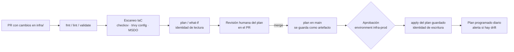

# 07 · Infraestructura como código (IaC)

> Bicep, Terraform y gobierno con políticas: cómo versionar, revisar, desplegar y proteger tu
> infraestructura de Azure desde pipelines.
> **Última revisión:** 24 de octubre de 2026.

[← Destinos de despliegue](06-destinos-de-despliegue-azure.md) · [Índice](../README.md) · [Siguiente: Seguridad y DevSecOps →](08-seguridad-devsecops.md)

---

## En esta guía

- [TL;DR](#tldr)
- [Principios](#principios)
- [¿Bicep, Terraform u otra?](#bicep-terraform-u-otra)
- [Bicep a fondo](#bicep-a-fondo)
- [Terraform a fondo](#terraform-a-fondo)
- [IaC en el pipeline](#iac-en-el-pipeline)
- [Gobierno: Azure Policy, landing zones y el retiro de Blueprints](#gobierno-azure-policy-landing-zones-y-el-retiro-de-blueprints)
- [Convenciones de nombres y etiquetas](#convenciones-de-nombres-y-etiquetas)
- [Checklist](#checklist)
- [Referencias](#referencias)

---

## TL;DR

- **Todo cambio de infraestructura entra por PR** con *plan*/*what-if* visible y se aplica desde el
  pipeline, nunca desde una laptop.
- **Bicep** (0.48) es la opción nativa de Azure; **Terraform** (1.17 + AzureRM **5.x**) si eres
  multi-nube o ya tienes el ecosistema. Ambos con **Azure Verified Modules (AVM)**.
- **Deployment stacks** reemplazan a **Azure Blueprints**, que se retira el **31-ene-2027**.
- AzureRM 5.0 (jul-2026) **ya no registra resource providers** por defecto: regístralos aparte.

---

## Principios

1. **Declarativo e idempotente**: aplicar dos veces da el mismo resultado.
2. **Mismo código, distintos parámetros** por ambiente (`main.dev.bicepparam`, `prod.tfvars`).
3. **Previsualiza siempre**: `what-if` / `terraform plan` en el PR; aplica **exactamente** lo revisado.
4. **Identidades separadas** para *plan* (lectura) y *apply* (escritura), federadas (OIDC).
5. **Módulos pequeños y versionados**; preferir AVM antes que escribir todo desde cero.
6. **Detecta drift**: plan programado que falla si alguien cambió algo a mano.
7. **Un solo dueño por propiedad**: si el pipeline de la app cambia *app settings*, el IaC no debe
   sobrescribirlos (o viceversa).
8. **Roll-forward** como estrategia por defecto: revertir IaC es un nuevo commit, no un `destroy`.

---

## ¿Bicep, Terraform u otra?

| Criterio | **Bicep** | **Terraform (AzureRM/AzAPI)** | Pulumi | ARM JSON |
| --- | --- | --- | --- | --- |
| Alcance | Sólo Azure (+ extensiones: Microsoft Graph, Kubernetes) | Multi-nube y SaaS | Multi-nube, lenguajes generales | Sólo Azure |
| Estado | Lo gestiona Azure (sin archivo de estado) | **Archivo de estado** (Azure Storage) que debes proteger | Servicio o backend propio | Azure |
| Día 0 de nuevas APIs | Inmediato (tipos generados) | AzAPI inmediato; AzureRM cuando se implementa | Proveedor nativo | Inmediato |
| Preview de cambios | `what-if` (deployments y stacks) | `plan` | `preview` | `what-if` |
| Gestión del ciclo de vida | **Deployment stacks** (deny settings, borrado de no gestionados) | Nativa (estado) | Nativa | Modo *Complete* (riesgoso) |
| Módulos oficiales | AVM (`br/public:avm/...`) | AVM para Terraform | — | — |
| Versión (oct-2026) | 0.48.x | Terraform 1.17, AzureRM 5.11, AzAPI 2.13 (OpenTofu 1.13 como alternativa) | — | — |

> [!TIP]
> Elige **una** herramienta principal por organización y documenta la excepción. Mezclar ambas sobre
> los **mismos recursos** es la receta para drift y borrados accidentales.

---

## Bicep a fondo

### Estructura recomendada

```text
infra/bicep/
├── main.bicep              # orquestación (targetScope)
├── main.bicepparam         # parámetros por ambiente (o main.<env>.bicepparam)
├── bicepconfig.json        # reglas del linter (errores rompen el build)
└── modules/                # módulos propios; prefiere AVM para lo estándar
```

### Azure Verified Modules

```bicep
// Módulo oficial desde el registro público, con versión fija
module site 'br/public:avm/res/web/site:<versión>' = {
  name: 'site-${uniqueString(resourceGroup().id)}'
  params: {
    name: 'app-miapp-prod'
    kind: 'app,linux'
    serverFarmResourceId: plan.id
    managedIdentities: { systemAssigned: true }
  }
}
```

### Parámetros, tipos y secretos

- `.bicepparam` con `using './main.bicep'` y `readEnvironmentVariable('NOMBRE', 'default')` para
  valores que inyecta el pipeline.
- **Tipos definidos por el usuario** (`type`, `@discriminator`, `@sealed`) para validar objetos
  complejos en tiempo de compilación.
- Secretos: `@secure()` en parámetros; mejor aún, **referencias a Key Vault** (`getSecret()` en
  `.bicepparam`) o identidades administradas para que no existan secretos.

### Linter y validaciones

`bicepconfig.json` con reglas como `use-recent-api-versions`, `no-hardcoded-env-urls`,
`outputs-should-not-contain-secrets` y `secure-secrets-in-params` en nivel `error`
(ver [`examples/bicep/bicepconfig.json`](../examples/bicep/bicepconfig.json)).

```bash
bicep lint infra/bicep/main.bicep
bicep build-params infra/bicep/main.bicepparam --stdout > /dev/null
az deployment group what-if -g rg-miapp-prod -f infra/bicep/main.bicep -p infra/bicep/main.bicepparam
```

### Deployment stacks

Un *deployment stack* (`Microsoft.Resources/deploymentStacks`) gestiona un conjunto de recursos como
**unidad**:

| Opción | Valores | Recomendación |
| --- | --- | --- |
| `--action-on-unmanage` | `detachAll`, `deleteResources`, `deleteAll` | Empieza con `detachAll`; pasa a `deleteResources` cuando confíes en el proceso |
| `--deny-settings-mode` | `none`, `denyDelete`, `denyWriteAndDelete` | `denyDelete` en producción; excluye la identidad del pipeline si usas `denyWriteAndDelete` |
| Roles | **Azure Deployment Stack Contributor** / **Owner** | *Owner* sólo para quien gestiona deny settings |

```bash
az stack group create --name miapp-prod --resource-group rg-miapp-prod \
  --template-file main.bicep --parameters main.bicepparam \
  --action-on-unmanage detachAll --deny-settings-mode denyDelete --yes

# Novedad 2026: what-if específico de stacks (resultado persistido de 1 a 3 h)
az stack-whatif group create --name preview-pr-212 --resource-group rg-miapp-prod \
  --stack-id "$(az stack group show -n miapp-prod -g rg-miapp-prod --query id -o tsv)" \
  --template-file main.bicep --parameters main.bicepparam \
  --action-on-unmanage detachAll --deny-settings-mode denyDelete --retention-interval PT1H
```

**Template specs** guardan plantillas versionadas como recursos de Azure (útil para catálogos de
autoservicio); un **registro privado de módulos Bicep** en ACR es la alternativa para módulos internos.

---

## Terraform a fondo

### Versiones y cambios relevantes

| Versión | Novedades que importan en CI/CD |
| --- | --- |
| Terraform 1.10–1.11 | Valores/recursos **efímeros** y atributos **write-only**: secretos que no quedan en el estado |
| 1.14 (nov-2025) | **List resources** y `terraform query` (descubrir/importar), **actions** (operaciones fuera del CRUD) |
| 1.15 (abr-2026) | `validate` revisa el bloque `backend`; variables/locals en `source`/`version` de módulos; `deprecated` en variables |
| 1.16 (ago-2026) | `import` dentro de módulos; `terraform_data.store` para valores efímeros entre plan y apply |
| 1.17 (oct-2026) | **Terraform Policy GA** (`-policies` en plan/apply/query), `-minimal-refresh`, variables en `required_providers` |
| **AzureRM 5.0** (27-jul-2026) | `resource_provider_registrations` = `none` por defecto (y se eliminó `skip_provider_registration`), `enhanced_validation` dentro de `features` y desactivado por defecto, *preflight validation* opcional, recursos obsoletos eliminados |

### Configuración base

```hcl
terraform {
  required_version = ">= 1.14.0, < 2.0.0"
  required_providers {
    azurerm = {
      source  = "hashicorp/azurerm"
      version = "~> 5.11"
    }
  }
  backend "azurerm" {}       # valores en backend.hcl; auth con Entra ID (use_azuread_auth = true)
}

provider "azurerm" {
  features {
    enhanced_validation {
      preflight_enabled = true   # opcional: valida payloads contra la API de preflight en el plan
    }
  }
  storage_use_azuread = true
}
```

Ejemplo completo y validado: [`examples/terraform/`](../examples/terraform/).

### Estado remoto en Azure Storage

- Cuenta de Storage dedicada, **sin shared keys** (`allowSharedKeyAccess=false`), acceso por **Entra ID**
  (`use_azuread_auth = true`) con rol **Storage Blob Data Contributor** sólo para las identidades de IaC.
- **Versionado de blobs** + *soft delete* para recuperar estados; **bloqueo** por *lease* de blob.
- Un estado por ambiente y por componente (red, datos, app): reduce el radio de impacto y los bloqueos.
- El estado contiene datos sensibles: Private Endpoint, firewall y auditoría.

### Lock file y versiones

```bash
# Hashes para todas las plataformas donde corre Terraform (CI Linux, Mac y Windows del equipo)
terraform providers lock -platform=linux_amd64 -platform=darwin_arm64 -platform=windows_amd64
git add .terraform.lock.hcl
```

### Patrones útiles

- `moved {}` para refactorizar sin destruir; `import {}` para adoptar recursos existentes
  (o `terraform query` para descubrirlos y generar configuración).
- `check {}` y `terraform test` para validar invariantes (por ejemplo, que `https_only` sea `true`).
- **AzAPI** para propiedades o servicios que aún no expone AzureRM.
- `-detailed-exitcode` en el plan: `0` sin cambios, `2` con cambios, `1` error (útil para drift y
  para saltar el apply).

---

## IaC en el pipeline



| Plataforma | Ejemplo |
| --- | --- |
| Azure Pipelines + Terraform | [`infra-terraform.yml`](../examples/azure-pipelines/infra-terraform.yml) |
| Azure Pipelines + Bicep | [`infra-bicep.yml`](../examples/azure-pipelines/infra-bicep.yml) |
| GitHub Actions + Terraform | [`infra-terraform.yml`](../examples/github-actions/infra-terraform.yml) |
| GitHub Actions + Bicep | [`infra-bicep.yml`](../examples/github-actions/infra-bicep.yml) |

> [!WARNING]
> Un `terraform plan` en un PR ejecuta código del PR (providers, `external` data sources) con la
> identidad del pipeline. Por eso la identidad de *plan* debe ser de **sólo lectura** y nunca debe
> haber secretos de escritura disponibles en validaciones de PR.

---

## Gobierno: Azure Policy, landing zones y el retiro de Blueprints

- **Azure Policy** como guardarraíl: efectos `deny` (bloquear), `audit`, `modify` y
  `deployIfNotExists` (remediar). Gestiona definiciones, iniciativas y asignaciones **como código**
  (por ejemplo con *Enterprise Policy as Code*) y despliégalas por pipeline.
- **Azure Landing Zones** (aceleradores Bicep y Terraform basados en AVM) para management groups,
  red hub-spoke, identidad y políticas base.
- **Azure Blueprints se retira**: la eliminación por fases empezó el **31-jul-2026** y el retiro
  definitivo es el **31-ene-2027** (se borran definiciones y asignaciones y desaparecen sus *locks*).
  Migra a **deployment stacks** (preferido) + **template specs**; Azure Advisor muestra dónde se usa.
- **Defender for Cloud DevOps security** e integraciones como **Microsoft Security DevOps** escanean
  IaC (Bicep, ARM, Terraform) en el pipeline y conectan hallazgos con los recursos en Azure.

---

## Convenciones de nombres y etiquetas

Sigue las abreviaturas del **Cloud Adoption Framework**: `<tipo>-<app>-<ambiente>-<región>-<instancia>`.

| Recurso | Prefijo | Ejemplo |
| --- | --- | --- |
| Resource group | `rg` | `rg-miapp-prod-mxc` |
| App Service plan / Web App | `asp` / `app` | `asp-miapp-prod`, `app-miapp-prod` |
| Function App | `func` | `func-miapp-prod` |
| Container App / entorno | `ca` / `cae` | `ca-miapp-api-prod`, `cae-miapp-prod` |
| AKS | `aks` | `aks-plataforma-prod-mxc-01` |
| Container Registry | `cr` (sin guiones) | `crmiappprod` |
| Key Vault | `kv` | `kv-miapp-prod-001` |
| Log Analytics / App Insights | `log` / `appi` | `log-miapp-prod`, `appi-miapp-prod` |
| Identidad administrada | `id` | `id-github-miapp-prod` |

**Etiquetas mínimas** (impuestas con Azure Policy): `environment`, `owner`, `costCenter`,
`managed-by` (`bicep`/`terraform`), `repo` y, si aplica, `dataClassification`.

---

## Checklist

- [ ] Infra en el repo, con `fmt/lint/validate` + escaneo IaC en cada PR.
- [ ] Plan/what-if visible en el PR; apply sólo desde `main` con aprobación.
- [ ] Identidades separadas de plan (lectura) y apply (escritura), ambas federadas.
- [ ] Estado de Terraform con Entra ID, sin shared keys, versionado y con *soft delete*.
- [ ] `.terraform.lock.hcl` con hashes multiplataforma en el repo.
- [ ] Resource providers registrados fuera del pipeline (AzureRM 5.x).
- [ ] Deployment stacks con `denyDelete` en producción; plan de migración fuera de Blueprints.
- [ ] Detección de drift programada y alertada.

---

## Referencias

- [Bicep](https://learn.microsoft.com/azure/azure-resource-manager/bicep/overview) · [Deployment stacks](https://learn.microsoft.com/azure/azure-resource-manager/bicep/deployment-stacks) · [What-if de stacks](https://learn.microsoft.com/azure/azure-resource-manager/bicep/deployment-stacks-what-if)
- [Azure Verified Modules](https://azure.github.io/Azure-Verified-Modules/)
- [Terraform AzureRM: guía de actualización a 5.0](https://registry.terraform.io/providers/hashicorp/azurerm/latest/docs/guides/5.0-upgrade-guide)
- [Backend azurerm](https://developer.hashicorp.com/terraform/language/backend/azurerm)
- [Retiro de Azure Blueprints](https://learn.microsoft.com/azure/governance/blueprints/blueprint-retirement) y [migración a template specs](https://learn.microsoft.com/azure/governance/blueprints/migrate-to-template-specs)
- [Azure Policy](https://learn.microsoft.com/azure/governance/policy/overview) · [Enterprise Policy as Code](https://azure.github.io/enterprise-azure-policy-as-code/)
- [Convenciones de nombres del CAF](https://learn.microsoft.com/azure/cloud-adoption-framework/ready/azure-best-practices/resource-abbreviations)

[← Destinos de despliegue](06-destinos-de-despliegue-azure.md) · [Índice](../README.md) · [Siguiente: Seguridad y DevSecOps →](08-seguridad-devsecops.md)
