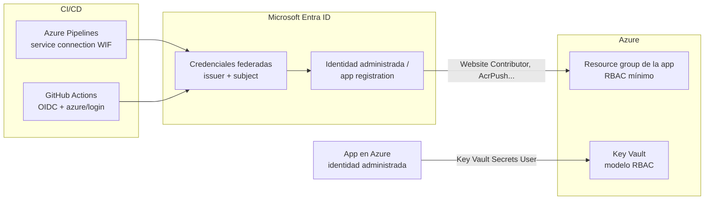
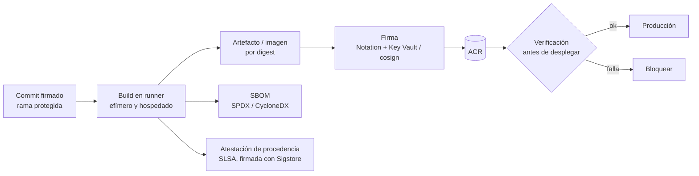

# 08 · Seguridad y DevSecOps

> El pipeline tiene las llaves de producción: cómo protegerlo y cómo asegurar la cadena de suministro
> de software de punta a punta.
> **Última revisión:** 24 de octubre de 2026.

[← Infraestructura como código](07-infraestructura-como-codigo.md) · [Índice](../README.md) · [Siguiente: Observabilidad y operación →](09-observabilidad-y-operacion.md)

---

## En esta guía

- [TL;DR](#tldr)
- [Modelo de amenazas: OWASP Top 10 CI/CD](#modelo-de-amenazas-owasp-top-10-cicd)
- [Identidad: cero secretos de larga vida](#identidad-cero-secretos-de-larga-vida)
- [Gestión de secretos](#gestión-de-secretos)
- [Capas de escaneo](#capas-de-escaneo)
- [Cadena de suministro: SBOM, procedencia y firmas](#cadena-de-suministro-sbom-procedencia-y-firmas)
- [Incidentes 2025–2026 y sus lecciones](#incidentes-20252026-y-sus-lecciones)
- [Cumplimiento y marcos de referencia](#cumplimiento-y-marcos-de-referencia)
- [Línea base de seguridad (checklist)](#línea-base-de-seguridad-checklist)
- [Referencias](#referencias)

---

## TL;DR

- **Identidad federada** (WIF/OIDC) + identidades administradas: si no hay secreto, no se puede robar.
- **Fija dependencias** (acciones por SHA o *lockfile*, versiones de tareas, imágenes por digest,
  lock files de paquetes) y actualízalas con PRs automáticos.
- **Escanea en el PR**: secretos (con *push protection*), código (CodeQL), dependencias, IaC y
  contenedores.
- **Firma y atestigua** lo que construyes (SBOM + procedencia SLSA) y **verifica** antes de desplegar.
- Desde octubre de 2025, Azure exige **MFA** también para CLI, PowerShell e IaC con cuentas de
  usuario: los pipelines deben usar **identidades de workload**, nunca usuarios.

---

## Modelo de amenazas: OWASP Top 10 CI/CD

| Riesgo | Ejemplo | Mitigación en Azure DevOps | Mitigación en GitHub |
| --- | --- | --- | --- |
| **SEC-1** Control de flujo insuficiente | Push directo a `main` que despliega | Branch policies, checks de environment | Rulesets, revisores requeridos, environments |
| **SEC-2** IAM inadecuado | Cuentas compartidas, PATs eternos | Entra ID, PATs restringidos, PATs globales retirados | SSO, tokens *fine-grained*, GitHub Apps |
| **SEC-3** Abuso de la cadena de dependencias | *Dependency confusion*, typosquatting | Azure Artifacts con *upstream sources* y vistas | Dependabot, dependency review, alertas de malware |
| **SEC-4** Poisoned Pipeline Execution | PR modifica el YAML para robar secretos | *Required template*, secretos sólo en `main`, aprobación para forks | `pull_request` sin secretos, nunca checkout de forks en `pull_request_target` |
| **SEC-5** PBAC insuficiente | Todos los pipelines usan la conexión de prod | Permisos por pipeline en service connections, *job auth scope* | Secretos/variables por environment, `permissions:` mínimos |
| **SEC-6** Higiene de credenciales | Secretos impresos en logs | WIF, Key Vault, enmascarado | OIDC, *push protection*, secret scanning |
| **SEC-7** Configuración insegura | Agentes self-hosted persistentes con acceso a la red | Managed DevOps Pools *stateless*, agente v5 actualizado | Runners efímeros, ARC, grupos de runners |
| **SEC-8** Terceros no gobernados | Extensión/acción con permisos de escritura | Revisión de extensiones, tareas *in-box* | Allowlist de acciones, pinning obligatorio por SHA |
| **SEC-9** Integridad de artefactos | Imagen reemplazada en el registry | Digest, firma (Notation), check *Evaluate artifact* | `actions/attest`, `gh attestation verify` |
| **SEC-10** Logging y visibilidad | Nadie ve quién cambió un pipeline | Auditoría + *streaming* a Azure Monitor/Sentinel | Audit log, *streaming* de auditoría (Enterprise) |

---

## Identidad: cero secretos de larga vida

Reglas:

1. **Una identidad por ambiente y propósito** (CI, despliegue dev, despliegue prod, IaC plan, IaC apply).
2. **RBAC al alcance mínimo** (resource group o recurso), roles específicos antes que `Contributor`, y
   nunca `Owner`/`User Access Administrator` para pipelines salvo justificación (p. ej. IaC que asigna roles,
   idealmente con condiciones de delegación).
3. **MFA obligatorio en Azure**: la fase 2 (desde el 1-oct-2025) exige MFA para operaciones de
   creación/actualización/borrado con Azure CLI, PowerShell, SDKs, REST e IaC **con cuentas de usuario**.
   Las identidades de workload (service principals, identidades administradas) no se ven afectadas.
   Migra cualquier "usuario de servicio" a una identidad de workload.
4. **Conditional Access para workload identities** (licencia Workload ID Premium) si necesitas
   restringir por ubicación o riesgo.
5. **Personas**: acceso just-in-time con **PIM**, sin permisos permanentes de escritura en producción.

---

## Gestión de secretos

| Situación | Mejor opción |
| --- | --- |
| La app necesita una cadena de conexión | **Identidad administrada** + RBAC del servicio de datos (SQL, Storage, Service Bus, Cosmos DB) |
| La app necesita un secreto de un tercero | **Key Vault** (modelo de permisos **RBAC**) + referencias de Key Vault en App Service/Functions/Container Apps o el *CSI driver* en AKS |
| El pipeline necesita un secreto | Variable group ligado a Key Vault (ADO) o secreto de **environment** (GitHub), con alcance mínimo |
| El pipeline necesita acceder a Azure | **WIF/OIDC**: no hay secreto |
| Publicar paquetes (npm, PyPI, NuGet) | **Trusted publishing** con OIDC donde el registro lo soporte; si no, tokens de vida corta con alcance a un paquete |

> [!CAUTION]
> Activa **push protection** de secret scanning: bloquea el `git push` que contiene un secreto antes
> de que llegue al historial. Un secreto que ya llegó a Git se considera comprometido aunque borres
> el commit: **rótalo**.

---

## Capas de escaneo

| Capa | Herramientas (Azure DevOps) | Herramientas (GitHub) | Cuándo bloquea |
| --- | --- | --- | --- |
| Secretos | **GitHub Secret Protection for Azure DevOps** (secret scanning + push protection) | Secret Protection | Siempre |
| Código (SAST) | **GitHub Code Security**: CodeQL (*default setup* GA jul-2026, sin YAML) + Copilot Autofix | CodeQL *default setup* / *advanced setup* + Autofix | Hallazgos críticos/altos nuevos en el PR |
| Dependencias (SCA) | Dependency scanning (con EPSS para priorizar desde oct-2026) | Dependabot alerts + **dependency review** | Vulnerabilidades altas nuevas, licencias prohibidas |
| Contenedores | Microsoft Defender for Containers, Trivy, Grype | Ídem + `docker scout` | Críticas sin parche disponible según política |
| IaC | Microsoft Security DevOps (checkov, templateanalyzer, trivy), Defender for Cloud | Ídem | *Misconfigurations* altas |
| Workflows/pipelines | Revisión de cambios en YAML (CODEOWNERS) | CodeQL para el lenguaje `actions`, OpenSSF Scorecard | Patrones peligrosos (inyección, `pull_request_target`) |
| DAST | OWASP ZAP contra staging | Ídem | Según riesgo |

> [!TIP]
> Las *status check policies* para alertas de Advanced Security en Azure Repos (roadmap 2026)
> y los *required status checks* en GitHub convierten los escaneos en **gates** de la rama.

---

## Cadena de suministro: SBOM, procedencia y firmas

| Práctica | Cómo hacerlo |
| --- | --- |
| **SBOM** | `docker/build-push-action` con `sbom: true`, `anchore/sbom-action` (Syft) o `sbom-tool` de Microsoft; adjúntalo al release y al registry |
| **Procedencia (SLSA)** | GitHub: `actions/attest@v4` (Build L2; L3 con un *reusable workflow* aislado). BuildKit: `provenance: mode=max` |
| **Firma de imágenes** | **Notation** (Notary Project) con certificados en Azure Key Vault, o **cosign** (Sigstore) |
| **Verificación** | `gh attestation verify`, Ratify/políticas de admisión en AKS, check *Evaluate artifact* en Azure Pipelines |
| **Dependencias** | Lock files, feeds privados con *upstream sources*, actualizaciones automáticas (Dependabot/Renovate) con revisión |
| **Builds reproducibles** | Versiones fijas de SDKs/imágenes base (por digest), sin `latest` |

**Niveles SLSA (Build track)**: L1 = existe procedencia; L2 = build hospedado + procedencia firmada;
L3 = plataforma endurecida con aislamiento entre builds y procedencia no falsificable.

---

## Incidentes 2025–2026 y sus lecciones

| Incidente | Qué pasó | Lección |
| --- | --- | --- |
| `tj-actions/changed-files` (mar-2025) | Con un token comprometido, los atacantes movieron los tags de la acción a un commit que imprimía secretos en los logs | Pin por SHA, rotación inmediata, logs públicos = secretos públicos |
| Gusanos tipo **Shai-Hulud** en npm (2025–2026) | Paquetes comprometidos que roban tokens y se auto-propagan publicando versiones maliciosas | *Trusted publishing* (OIDC), 2FA, cuarentena/edad mínima de versiones nuevas, alertas de malware |
| `aquasecurity/trivy-action` y `setup-trivy` (19-mar-2026, CVE-2026-33634) | Credenciales residuales de un incidente previo permitieron forzar tags a malware y publicar binarios maliciosos | Contención completa de credenciales tras un incidente; releases inmutables; pin por SHA/digest |
| `actions-cool/*` (may-2026) | Todos los tags redirigidos a un *imposter commit* que exfiltraba credenciales | La protección efectiva es fijar commits verificados (lockfile/SHA), no confiar en tags |

**Respuesta a un incidente de cadena de suministro** (runbook mínimo):

1. Identifica workflows/pipelines que ejecutaron la versión afectada (búsqueda en el código y en logs de la ventana).
2. **Rota** todos los secretos y tokens accesibles por esos jobs; revoca sesiones.
3. Fija versiones sanas (SHA/digest) y bloquea la acción/paquete en la política de la organización.
4. Revisa artefactos producidos en la ventana: reconstruye y vuelve a firmar si hay duda.
5. Documenta y comparte el postmortem.

---

## Cumplimiento y marcos de referencia

| Marco | Qué pide (resumen) | Evidencia desde CI/CD |
| --- | --- | --- |
| **NIST SSDF (SP 800-218)** | Prácticas de desarrollo seguro | Políticas de rama, escaneos, revisión, gestión de vulnerabilidades |
| **SLSA** | Integridad del proceso de build | Atestaciones de procedencia firmadas |
| **EU Cyber Resilience Act** | Para productos con elementos digitales en la UE: obligaciones de **reporte de vulnerabilidades explotadas desde el 11-sep-2026**; aplicación completa el **11-dic-2027** | SBOM, gestión y divulgación de vulnerabilidades, actualizaciones de seguridad |
| **ISO 27001 / SOC 2** | Control de cambios, accesos, auditoría | Historial de despliegues por environment, aprobaciones, logs de auditoría |
| **OpenSSF Scorecard** | Buenas prácticas en repos | Puntaje automatizado (pinning, branch protection, tokens) |

---

## Línea base de seguridad (checklist)

**Identidad y acceso**

- [ ] Cero secretos de Azure en pipelines: WIF (emisor Entra) / OIDC.
- [ ] Una identidad por ambiente, RBAC mínimo, sin `Owner` para pipelines.
- [ ] PATs globales eliminados antes del 1-dic-2026; creación de PATs restringida.
- [ ] Cuentas de usuario fuera de toda automatización (MFA obligatorio en Azure).

**Pipelines y workflows**

- [ ] Acciones/tareas fijadas (SHA o lockfile), allowlist de acciones y extensiones revisadas.
- [ ] `permissions` mínimos / *job authorization scope* limitado al proyecto.
- [ ] Sin ejecución de código de forks con secretos; runners/agentes efímeros.
- [ ] Cambios a `.github/`, `azure-pipelines/` e `infra/` revisados por CODEOWNERS.

**Código y dependencias**

- [ ] Secret scanning con push protection; CodeQL y dependency review como checks requeridos.
- [ ] Lock files y actualizaciones automáticas con PR.

**Artefactos**

- [ ] SBOM + atestación de procedencia en cada release; imágenes firmadas y por digest.
- [ ] Verificación antes de desplegar a producción.

**Detección y respuesta**

- [ ] Auditoría de Azure DevOps/GitHub enviada a Sentinel o Log Analytics.
- [ ] Runbook de incidente de cadena de suministro probado.

---

## Referencias

- [OWASP Top 10 CI/CD Security Risks](https://owasp.org/www-project-top-10-ci-cd-security-risks/)
- [SLSA](https://slsa.dev/) · [NIST SSDF](https://csrc.nist.gov/projects/ssdf)
- [GitHub Advanced Security for Azure DevOps](https://learn.microsoft.com/azure/devops/repos/security/configure-github-advanced-security-features)
- [Seguridad de Azure Pipelines](https://learn.microsoft.com/azure/devops/pipelines/security/overview)
- [Uso seguro de GitHub Actions](https://docs.github.com/actions/reference/security/secure-use)
- [Artifact attestations](https://docs.github.com/actions/concepts/security/artifact-attestations)
- [MFA obligatorio en Azure](https://learn.microsoft.com/entra/identity/authentication/concept-mandatory-multifactor-authentication)
- [Notation y Azure Key Vault](https://learn.microsoft.com/azure/container-registry/container-registry-tutorial-sign-build-push)
- [Microsoft Security DevOps](https://learn.microsoft.com/azure/defender-for-cloud/azure-devops-extension)

[← Infraestructura como código](07-infraestructura-como-codigo.md) · [Índice](../README.md) · [Siguiente: Observabilidad y operación →](09-observabilidad-y-operacion.md)
