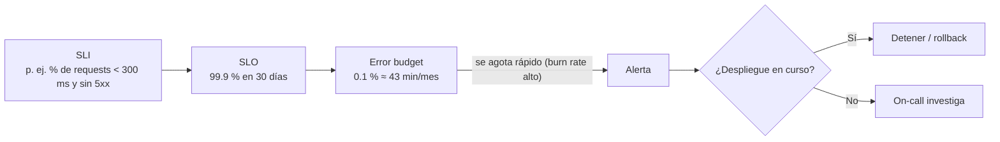

# 09 · Observabilidad y operación

> Saber qué versión corre, si está sana y cuánto cuesta entregarla: telemetría, SLOs, gates basados en
> métricas, respuesta a incidentes y costos de CI/CD.
> **Última revisión:** 24 de octubre de 2026.

[← Seguridad y DevSecOps](08-seguridad-devsecops.md) · [Índice](../README.md) · [Siguiente: Troubleshooting →](10-troubleshooting.md)

---

## En esta guía

- [TL;DR](#tldr)
- [Tres niveles de observabilidad](#tres-niveles-de-observabilidad)
- [Telemetría de aplicaciones con OpenTelemetry](#telemetría-de-aplicaciones-con-opentelemetry)
- [Marcar cada despliegue](#marcar-cada-despliegue)
- [SLOs, alertas y gates](#slos-alertas-y-gates)
- [Respuesta a incidentes](#respuesta-a-incidentes)
- [Salud del propio pipeline](#salud-del-propio-pipeline)
- [Costos de CI/CD](#costos-de-cicd)
- [Checklist](#checklist)
- [Referencias](#referencias)

---

## TL;DR

- Instrumenta con la **Azure Monitor OpenTelemetry Distro** y usa **connection strings** (la ingesta
  por *instrumentation key* dejó de tener soporte en marzo de 2025).
- Etiqueta la telemetría con la **versión** (`service.version`) y marca cada despliegue
  (anotaciones), para correlacionar "subió el error" con "desplegamos X".
- Define **SLOs** y usa sus alertas como **gates** automáticos y disparadores de rollback.
- Mide también el **pipeline**: duración, tasa de éxito, tiempo en cola, pruebas inestables y costo.

---

## Tres niveles de observabilidad

| Nivel | Preguntas | Señales | Herramientas en Azure |
| --- | --- | --- | --- |
| **Entrega** | ¿Qué tan rápido y estable entregamos? | DORA (lead time, frecuencia, fallos, recuperación, retrabajo) | Environments/deployments de ADO y GitHub, Analytics, DevLake |
| **Pipeline** | ¿El pipeline es rápido y confiable? | Duración, éxito, cola, *flaky tests*, minutos consumidos | Pipeline analytics (ADO), métricas de Actions (GitHub) |
| **Aplicación** | ¿La versión desplegada está sana? | Errores, latencia, saturación, negocio | Application Insights, Azure Monitor, Managed Prometheus, Grafana |

---

## Telemetría de aplicaciones con OpenTelemetry

- **Application Insights basado en workspace** (el modelo clásico se retiró en febrero de 2024).
- **Azure Monitor OpenTelemetry Distro** para .NET, Java, Node.js y Python: trazas, métricas y logs con
  un SDK estándar; exporta también a otros backends si lo necesitas.
- Configura **`APPLICATIONINSIGHTS_CONNECTION_STRING`** (no instrumentation keys) y, en entornos
  restringidos, autenticación de Entra ID para la ingesta (*local auth* deshabilitado).
- Atributos de recurso mínimos: `service.name`, `service.version` (= número de build) y
  `deployment.environment.name`.

```csharp
// Program.cs (.NET 10) — Azure Monitor OpenTelemetry Distro
// La versión viaja dentro del artefacto: dotnet publish -p:InformationalVersion=$(Build.BuildNumber)
var version = typeof(Program).Assembly
    .GetCustomAttribute<AssemblyInformationalVersionAttribute>()?.InformationalVersion ?? "dev";

builder.Services.AddHealthChecks();
builder.Services.AddOpenTelemetry()
    .UseAzureMonitor()            // lee APPLICATIONINSIGHTS_CONNECTION_STRING
    .ConfigureResource(r => r.AddAttributes(new Dictionary<string, object>
    {
        ["service.version"] = version,
        ["deployment.environment.name"] = builder.Environment.EnvironmentName,
    }));

var app = builder.Build();
app.MapHealthChecks("/healthz");   // lo usan el health check, el warm-up del swap y los smoke tests
```

---

## Marcar cada despliegue

Las **anotaciones de release** aparecen como marcadores en las gráficas de Application Insights.

- Las tareas de despliegue de App Service/Functions de Azure Pipelines pueden crearlas solas, pero
  sólo si el recurso está ligado mediante la *app setting* de instrumentation key heredada.
- Con connection strings (lo recomendado), créalas explícitamente desde el pipeline con la API de
  anotaciones (la misma que usa el script oficial de Microsoft):

```bash
# Requiere sesión de Azure CLI (OIDC/WIF) con permisos de escritura sobre el recurso de App Insights
ai_id=$(az resource show -g rg-miapp-prod -n appi-miapp-prod \
  --resource-type Microsoft.Insights/components --query id -o tsv)
body=$(jq -nc \
  --arg id "$(cat /proc/sys/kernel/random/uuid)" \
  --arg name "miapp ${BUILD_NUMBER}" \
  --arg time "$(date -u +%Y-%m-%dT%H:%M:%S)" \
  --arg props "{\"ReleaseName\":\"${BUILD_NUMBER}\",\"Environment\":\"prod\",\"Commit\":\"${COMMIT_SHA}\"}" \
  '{Id:$id, AnnotationName:$name, EventTime:$time, Category:"Deployment", Properties:$props}')
az rest --method put \
  --url "https://management.azure.com${ai_id}/Annotations?api-version=2015-05-01" \
  --body "$body"
```

Además:

- Los **environments** de Azure Pipelines y GitHub guardan el historial de despliegues (qué, cuándo,
  quién aprobó). La vista **Stages** de Azure Pipelines (2026) muestra qué versión hay en cada etapa.
- Publica un evento a tu canal del equipo (Teams/Slack) con versión, ambiente, commit y enlace al run.

---

## SLOs, alertas y gates



- **SLIs** típicos de una API: disponibilidad (respuestas no-5xx), latencia (p95/p99), saturación.
- **Alertas por *burn rate*** del error budget (rápida y lenta) en lugar de umbrales fijos ruidosos.
- **Gates basados en alertas**:
  - Azure Pipelines: check **Query Azure Monitor alerts** en el environment (antes y después del
    despliegue) o un `Delay@1` de *bake time* seguido de la verificación.
  - GitHub: *custom deployment protection rule* (GitHub App que consulta Azure Monitor) o un job que
    evalúe las alertas antes de promover.
- **Pruebas sintéticas**: *availability tests* de Application Insights contra `/healthz` y una
  transacción crítica.
- Política de **error budget**: si se agota, se congelan las funciones nuevas y se prioriza estabilidad.

---

## Respuesta a incidentes

| Fase | Práctica |
| --- | --- |
| Detectar | Alertas accionables con *runbook* enlazado; nada de alertas que nadie atiende |
| Mitigar | **Primero restaurar** (rollback, flag off, escalar), después diagnosticar |
| Comunicar | Canal de incidente, roles (incident commander, comunicaciones), página de estado |
| Aprender | **Postmortem sin culpables** con acciones con dueño y fecha; cuenta como retrabajo en DORA |

> [!TIP]
> Mide el **tiempo de recuperación** desde la alerta (o el despliegue fallido) hasta la restauración.
> Si el rollback toma más de 5 minutos o requiere pasos manuales, automatízalo antes de optimizar otra cosa.

---

## Salud del propio pipeline

| Indicador | Objetivo orientativo | Dónde verlo |
| --- | --- | --- |
| Duración de validación de PR (p50/p90) | < 10 min | Pipeline analytics (ADO), métricas de Actions |
| Tasa de éxito en `main` | > 90 % | Analytics / historial de runs |
| Tiempo en cola | < 1 min | *Pool consumption report* (ADO), métricas de runners |
| Pruebas inestables | Tendencia a 0 | *Flaky test detection* (ADO Test Analytics) |
| Re-ejecuciones manuales | Raras | Historial de runs |

---

## Costos de CI/CD

| Palanca | Azure DevOps | GitHub Actions |
| --- | --- | --- |
| Capacidad | Paralelismo (hospedado ~US$40/mes, self-hosted ~US$15/mes por job); GitHub-hosted agents por minuto | Minutos incluidos por plan y luego por minuto (precios reducidos en 2026) |
| Runners propios | Managed DevOps Pools: VMs de Azure + paralelismo self-hosted; *standby agents* cuestan horas encendidas | Self-hosted/ARC: tu infraestructura |
| Duración | Caché, paralelización, *path filters*, `batch: true` | Caché, `concurrency` con `cancel-in-progress` en PRs, `paths` |
| Almacenamiento | Retención de runs y artefactos; Azure Artifacts > 2 GiB | Retención de artefactos/logs; caché > 10 GB es facturable |
| Seguridad (licencias) | Secret Protection / Code Security por *committer* activo | Ídem en GitHub |
| Visibilidad | Azure Cost Management (GitHub-hosted agents y Copilot code review con etiquetas por proyecto) | *Billing & usage*, presupuestos |

> [!NOTE]
> GitHub redujo hasta 39 % el precio de los runners hospedados el 1-ene-2026 y **pospuso** el cargo
> anunciado para minutos de runners self-hosted. Revisa la página de facturación antes de presupuestar.

---

## Checklist

- [ ] OpenTelemetry (Azure Monitor Distro) con `service.version` y connection string.
- [ ] Endpoint `/healthz` con dependencias críticas.
- [ ] Anotación/evento por despliegue con versión, ambiente y commit.
- [ ] SLOs definidos con alertas de *burn rate* y *runbooks*.
- [ ] Gates de despliegue basados en alertas o métricas.
- [ ] Dashboard de salud del pipeline y de costos revisado mensualmente.

---

## Referencias

- [Azure Monitor OpenTelemetry Distro](https://learn.microsoft.com/azure/azure-monitor/app/opentelemetry-enable)
- [Release annotations](https://learn.microsoft.com/azure/azure-monitor/app/release-and-work-item-insights)
- [Connection strings en Application Insights](https://learn.microsoft.com/azure/azure-monitor/app/connection-strings)
- [Approvals and checks: Query Azure Monitor alerts](https://learn.microsoft.com/azure/devops/pipelines/process/approvals#query-azure-monitor-alerts)
- [Custom deployment protection rules](https://docs.github.com/actions/how-tos/deploy/configure-and-manage-deployments/create-custom-protection-rules)
- [Google SRE Book — Service Level Objectives](https://sre.google/sre-book/service-level-objectives/)

[← Seguridad y DevSecOps](08-seguridad-devsecops.md) · [Índice](../README.md) · [Siguiente: Troubleshooting →](10-troubleshooting.md)
